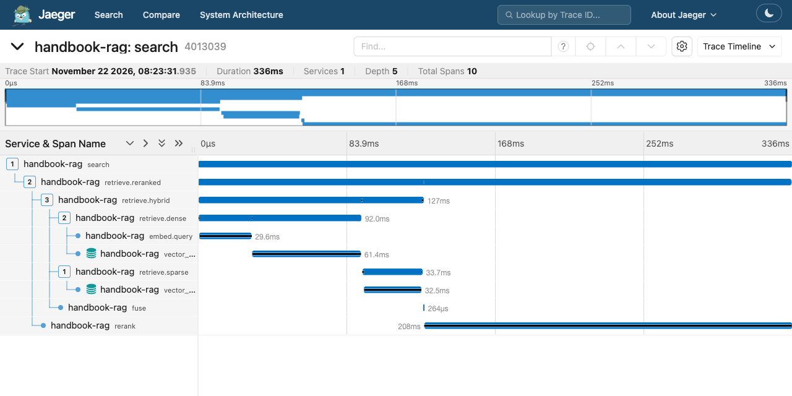

# Production RAG Pipeline

A knowledge assistant that answers questions from a company handbook, built the way a production team would build it: answers grounded in retrieved passages and cited, quality measured by an evaluation suite, and every request traced for latency and cost.

**Status: the assistant answers real questions with citations. Search is built, measured, served and traced; measuring the answers is next.**

- The handbook is indexed, and hybrid search is the default, chosen on a checked set of test questions.
- It runs as a service: an HTTP API, and `docker compose up` for the whole system.
- Every request is traced, stage by stage.
- CI fails when retrieval breaks.
- `ask` retrieves passages and has a language model write an answer that cites them, or says the handbook does not cover the question. It runs on Gemini with a free API key, and ran for real on 22 November 2026.
- Not done yet: the answers are not measured, `ask` is a command and not an HTTP endpoint, and the model call is not traced.

This README is updated as each milestone lands.

## Documents

| Document | What it covers |
|---|---|
| [Project charter](docs/charter.md) | The problem, the users, success metrics and non-goals |
| [Architecture](docs/architecture.md) | How the system works, with diagrams and a glossary |
| [Decision records](docs/adr/) | Why each major technical choice was made |
| [Roadmap](docs/roadmap.md) | Milestones and how work flows |
| [Evaluation](docs/evaluation.md) | The golden set, the metrics and how to read a run |
| [Observability](docs/observability.md) | How a request is traced, and how to read a trace to debug it |
| [Experiments](docs/experiments/) | What was tried, with numbers, including what did not work |

## Planned scope

- **Retrieval and generation**: ingest documents, retrieve the relevant passages, and answer with citations
- **Evaluation**: a curated test set with retrieval and answer-quality metrics, run in CI so regressions are caught
- **Observability**: traces, latency, and cost for every request
- **Production engineering**: tested code, CI, containerized services, and written design decisions

## Results so far

Retrieval on 132 test questions over 38,881 chunks of the handbook. These are the rows `baseline` to `v3` of what `uv run handbook-rag eval-table --metric hit@5 --metric hit@1 --metric mrr@10` prints from the runs in [`evals/runs/retrieval`](evals/runs/retrieval). The rows after them are the experiments linked below.

| Run | What it is | Questions | Hit@5 (95% interval) | Hit@1 | MRR@10 | Median time |
|---|---|---|---|---|---|---|
| baseline | Dense retrieval only (bge-small-en-v1.5). | 132 | 0.856 (0.795 to 0.909) | 0.583 | 0.705 | 26 ms |
| v1 | Keyword search only (BM25). | 132 | 0.932 (0.886 to 0.970) | 0.727 | 0.813 | 10 ms |
| v2 | Dense and BM25 merged with reciprocal rank fusion. | 132 | 0.962 (0.924 to 0.992) | 0.697 | 0.807 | 33 ms |
| v3 | Hybrid, then the top 30 reranked by a cross-encoder (ms-marco-MiniLM-L6-v2). | 132 | 0.939 (0.894 to 0.977) | 0.773 | 0.852 | 247 ms |

- **Hybrid search is the default.** It clearly beats dense search alone: +0.106 on Hit@5 (95% interval +0.053 to +0.159), with 14 questions gained and none lost. Against keyword search alone the picture is not clear: hybrid is ahead at five results (+0.030, an interval that includes zero) and behind at rank 1. That choice rests partly on judgement, and [ADR 0011](docs/adr/0011-hybrid-retrieval-by-default.md) says why.
- **Reranking is off by default.** It brings no clear gain at five results, and it makes search about seven times slower.
- **Two experiments did not help**, and are written up anyway: half-size chunks, and other settings of the rank fusion ([experiment log](docs/experiments/2026-11-22-chunk-size-and-fusion.md)).
- **CI catches broken retrieval.** Every pull request is scored with the real models on a slice of the handbook, and fails if a score falls below a recorded minimum. That detects breakage, such as losing either half of hybrid search. It does not detect a change that costs one or two questions ([ADR 0012](docs/adr/0012-retrieval-gate-on-a-slice.md)).
- **Targets.** The [charter](docs/charter.md) asks for Recall@5 of at least 0.85 and MRR@10 of at least 0.70. Hybrid search reaches 0.962 and 0.807. Answer quality is not measured yet.

**How far to trust these numbers.** The test questions were made by one model session and checked by another, over several rounds. No person has verified them one by one, and most were written by a model that could see the passage. The [dataset card](evals/golden/README.md) says how the set was made, what the checks found, and what its limits are.

## HTTP API

`make serve` runs the assistant as a service. It needs the index (`make qdrant`, `make index`).

```bash
curl -s localhost:8000/health
# {"status":"ok","version":"0.1.0","chunks":38881,"detail":null}

curl -s -X POST localhost:8000/search \
  -H 'Content-Type: application/json' \
  -d '{"query": "how do I expense a laptop", "limit": 2}'
```

`POST /search` returns the passages most relevant to a question, best first. Each has its text, its page, the headings above it, a link to the page and a score. The response also says how the passages were found and how long that took, and carries the id of the request's trace when tracing is on.

| Endpoint | What it does |
|---|---|
| `POST /search` | `query` (1 to 500 characters), optional `limit` (1 to 20) and `section` |
| `GET /health` | 200 with the number of chunks in the index. 503 if the vector store cannot be reached, the index has not been built, or it is empty, and it says which |
| `GET /docs` | Interactive documentation, generated from the code |

- **Bad requests.** A request that breaks a limit gets a 422 that names the field, without repeating what was sent. A body over 8 KB gets a 413.
- **A vector store that is down** gets a 503 with a fixed message, not a 500. The cause goes to the service's log, because it can name internal addresses. The service starts without the store and works as soon as the store is there.
- **Trace id.** With tracing on, every response to `/search` carries the id of its trace in the `X-Trace-Id` header, a failed one too.
- **Speed.** The models are loaded and run once when the service starts. Measured on the full index, searches one after another took 77 to 88 ms, and 124 to 169 ms after 20 to 60 idle seconds.
- **The embedding model runs on the CPU here**, also on a machine with a GPU. A service embeds one question at a time, which a CPU does as fast and more steadily: on an Apple GPU, the first search after a few idle seconds took over a second. `HANDBOOK_RAG_EMBEDDING_DEVICE` changes it.
- **Not built for the open internet.** There is no authentication, no rate limit and no limit on requests in flight. The service listens on this machine only unless `HANDBOOK_RAG_API_HOST` says otherwise.
- `POST /ask`, which answers with citations and streams the answer, is the next step.

## Tracing

Every request is one trace, with a span for each stage, so a slow or wrong result can be followed to the stage that caused it.



`make traces` starts the viewer. [docs/observability.md](docs/observability.md) explains how to read a trace, what is deliberately left out of one, and what the first traces showed.

## Run it with Docker

One command starts the API, the vector store and the trace backend. Only Docker is needed.

```bash
docker compose up --detach --build                  # build the image and start everything
docker compose run --rm api handbook-rag snapshot   # download the handbook (43 MB)
docker compose run --rm api handbook-rag index      # embed it and store it in Qdrant
curl -s localhost:8000/health
```

The first build downloads about half a gigabyte and took four minutes here. The image is 2.2 GB, most of it PyTorch.

| Address | What is there |
|---|---|
| <http://localhost:8000/docs> | The API and its documentation |
| <http://localhost:16686> | Traces of every request |
| <http://localhost:6333/dashboard> | Qdrant's own dashboard |

- **Indexing is the slow step.** In a container the embedding model runs on the CPU: at the speed measured in CI that is 45 to 56 minutes for the whole handbook. Indexing can be stopped and started again; it skips what is already stored.
- **Wait for `Index ready`.** Before the first chunks are stored, `/health` answers 503 and says the index has not been built. It turns 200 as soon as some chunks are stored, while indexing is still running, and searches then see only part of the handbook.
- **Indexed already with `make index`?** The containers use the same Qdrant, so there is nothing to do again, as long as the settings that name the index (the handbook commit, the models, the chunk sizes) are the defaults.
- **Settings.** The containers do not read a `.env` file. They use the defaults, plus what `compose.yaml` lists under `environment:`.
- **Port 8000.** The API container holds it, so stop it with `docker compose stop api` before running `make serve`.
- Everything listens on this machine only. Nothing here has authentication.

## Data

The assistant is built on the [GitLab Handbook](https://handbook.gitlab.com/), which GitLab publishes under the [CC BY-SA 4.0](https://creativecommons.org/licenses/by-sa/4.0/) licence. The handbook text is not stored in this repository. `make snapshot` downloads its Markdown pages at a pinned commit (4,206 pages, 43 MB) and writes a manifest that records the source, commit and a checksum of what was fetched. The reasoning is in [ADR 0002](docs/adr/0002-handbook-corpus.md).

`make chunks` cleans the pages and splits them along their headings into 38,881 chunks with a median of 225 tokens, none longer than the embedding model can read. How and why is in [ADR 0009](docs/adr/0009-structure-aware-chunking.md).

The test questions in [`evals/golden/`](evals/golden/README.md) quote short passages from the handbook. That folder is therefore licensed CC BY-SA 4.0 and credits GitLab, separately from the code, which is under the MIT licence.

This project is not affiliated with or endorsed by GitLab.

## Development

You need [uv](https://docs.astral.sh/uv/), `make`, `git` and Docker.

```bash
make install    # install dependencies and git hooks
make check      # lint, type check and fast tests: everything CI runs
make snapshot   # download the handbook at the pinned commit into data/
make chunks     # clean and chunk it, and print a summary
make qdrant     # start the Qdrant vector store in Docker
make index      # embed the chunks and store them; safe to run again
make search q="how do I expense a laptop"
make traces     # start the trace backend; see docs/observability.md
make serve      # run the HTTP API at http://127.0.0.1:8000
uv run handbook-rag search "what is compa-ratio" --rerank
make ask q="how do I expense a laptop"   # answer with citations; needs a free Gemini API key
make test-live       # send two real requests to the answer model
make golden-check    # verify every test question against the handbook
make eval-retrieval  # score the default search, as a scratch run named "current"
make eval-table      # print a results table with one row per run on disk
make eval-gate       # the retrieval check CI runs, on a slice of the handbook
```

### Answers

```console
$ make ask q="How many days of paid time off can I take, and do I need approval?"
GitLab does not set a specific annual limit on the amount of Flexible PTO you can take. However, time off exceeding 25 consecutive calendar days requires special permission from your Manager, People Business Partner, and the Absence Management Team.

You do need to coordinate your planned time off with your manager in advance and make a coverage plan.

Sources
  [1] GitLab Canada Corp > Time Away & Leave > Paid Time Off & Vacation
      https://handbook.gitlab.com/handbook/total-rewards/benefits/general-and-entity-benefits/canada-corp-benefits/
  [2] Time Off Types > Flexible Paid Time Off (PTO) > Overview
      https://handbook.gitlab.com/handbook/people-group/time-off-and-absence/time-off-types/

gemini-3.5-flash-lite | 1,728 tokens in | 79 out | 2.0 s
```

That is real output from 22 November 2026. A question the handbook does not cover gets one fixed sentence, "I could not find this in the handbook.", and no sources.

- **The model.** Answers are written by Gemini (`gemini-3.5-flash-lite`). Copy `.env.example` to `.env` and set `GEMINI_API_KEY`. [Google AI Studio](https://aistudio.google.com/) gives a key free of charge, without setting up billing. The `.env` file is ignored by git, and the key is read only by this application.
- **A free key is for public text only.** On the free tier Google may use what is sent to improve its products. The handbook is public, so that is fine here. It would not be for private documents.
- **Citations.** The passages are numbered, the model names the numbers, and code checks that each number belongs to a passage that was really sent. Brackets inside code, such as `argv[1]`, are left alone. That check cannot tell whether the passage supports the statement, which is what the answer evaluation is for.
- **Claude instead.** Set `HANDBOOK_RAG_ANSWER_MODEL=claude-haiku-5-5` and `ANTHROPIC_API_KEY`. Claude's API returns the quoted words with every citation, a stronger guarantee. This path is unit-tested and has not been run against the Claude API yet.
- The reasoning for all of this is in [ADR 0013](docs/adr/0013-gemini-free-tier-with-marker-citations.md).

The workflow and conventions are in [CONTRIBUTING.md](CONTRIBUTING.md).
