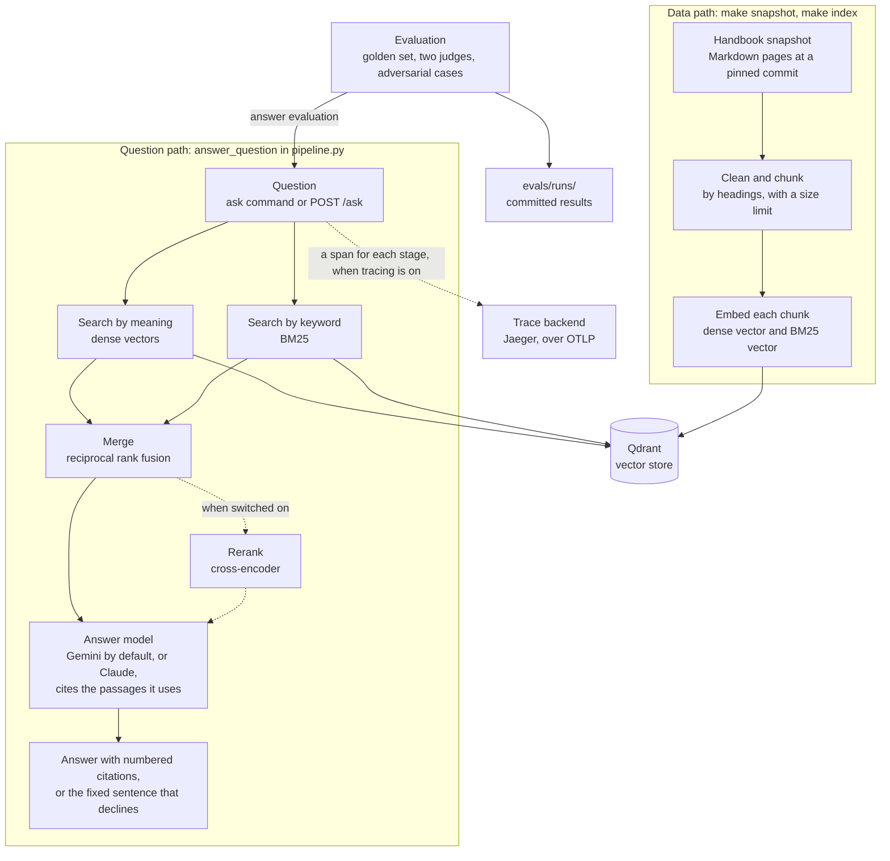

# Handbook RAG

A knowledge assistant that answers questions from the public [GitLab handbook](https://handbook.gitlab.com/). It finds the passages that answer a question, has a language model write an answer that cites them by number, and says so when the handbook does not cover the question. It was built the way a production team would build it: written decisions, an evaluation with confidence intervals, CI, tracing, an HTTP API and Docker.

**Status: version 1.0.0, 23 November 2026.** It answers real questions on the command line and over HTTP. Its search, its answers and its weak points are measured by runs committed to this repository. What is not done is listed under [Limitations](#limitations), and the [changelog](CHANGELOG.md) says what this version contains.

## How it works



- **Data path.** `make snapshot` downloads the handbook's Markdown pages at a pinned commit ([ADR 0002](docs/adr/0002-handbook-corpus.md)). `make index` cleans each page, cuts it into chunks along its headings ([ADR 0009](docs/adr/0009-structure-aware-chunking.md)), and stores two vectors for each chunk in Qdrant: a dense one for meaning and a sparse one for exact words ([ADR 0004](docs/adr/0004-qdrant-as-vector-store.md), [ADR 0005](docs/adr/0005-local-embedding-and-reranking-models.md)). A newer commit of the handbook can be indexed into a collection of its own by reusing the vectors of every chunk whose embedded text has not changed, so only what changed is embedded again ([ADR 0019](docs/adr/0019-updating-the-index-by-reusing-vectors.md)).
- **Question path.** One function, `answer_question` in [`pipeline.py`](src/handbook_rag/pipeline.py), serves the `ask` command, `POST /ask` and the answer evaluation. It searches both ways and merges the two lists. Reranking is available and off by default ([ADR 0011](docs/adr/0011-hybrid-retrieval-by-default.md)). The model writes a number such as `[2]` after each statement, and code checks that the number names a passage that was really sent ([ADR 0013](docs/adr/0013-gemini-free-tier-with-marker-citations.md)). When the passages do not hold the answer, the reply is one fixed sentence with no sources ([ADR 0010](docs/adr/0010-search-result-blocks-and-declining.md)). A request to the model has a time limit, a failed one is asked again when that may help, and a second model can stand in ([ADR 0018](docs/adr/0018-time-limits-retries-and-a-fallback.md)). An answer stored earlier is served again without a request, to the same question or to one that a second model judges to mean the same, and it names the question it was written for ([ADR 0020](docs/adr/0020-an-answer-cache-that-matches-by-meaning.md)).
- **Evaluation.** The answer evaluation and the adversarial questions from outside the handbook call that same function, without the answer cache: they measure the search and the model that run, and never an answer that was stored. The retrieval evaluation calls the search alone, the adversarial cases with a planted passage give their passages to the answer model directly, and the judges call the model with their own instructions. Every run is committed under [`evals/runs/`](evals/runs) ([ADR 0007](docs/adr/0007-evaluation-strategy.md), [ADR 0014](docs/adr/0014-answer-evaluation-in-stages.md)).
- **Tracing** records every stage of a request as a span. It is off by default and on in Docker Compose ([ADR 0008](docs/adr/0008-opentelemetry-tracing.md)).

[The architecture document](docs/architecture.md) has the full picture, the components and a glossary.

## Quickstart

You need [uv](https://docs.astral.sh/uv/), `make`, `git` and Docker. uv installs the right Python version. Search needs no account. Answers need a free Gemini API key.

1. **Get the code and its dependencies.**

   ```bash
   git clone https://github.com/MumukshuPanchal/handbook-rag.git
   cd handbook-rag
   make install    # install dependencies and git hooks
   ```

2. **Download the handbook.** `make snapshot` fetches its Markdown pages at the pinned commit into `data/`, and writes a manifest of what was fetched.

3. **Start the vector store.** `make qdrant` starts Qdrant in Docker, listening on this machine only.

4. **Build the index.** `make index` cleans and chunks the pages, embeds every chunk and stores it in Qdrant. This is the slow step, and the first run also downloads the models. On a CPU, at the speed measured in CI, the whole handbook takes 45 to 56 minutes ([ADR 0012](docs/adr/0012-retrieval-gate-on-a-slice.md)). A GPU is used when there is one: on the development laptop the embedding model ran about twice as fast on its Apple GPU as on its CPU ([ADR 0005](docs/adr/0005-local-embedding-and-reranking-models.md)). Indexing can be stopped and run again; it skips what is already stored as it would be stored now.

   Search works from here on, without a key: `make search q="how do I expense a laptop"`.

5. **Add a free Gemini key.** Copy `.env.example` to `.env` and set `GEMINI_API_KEY`. [Google AI Studio](https://aistudio.google.com/) gives a key free of charge, without setting up billing. The `.env` file is ignored by git, and the key is read only by this application. On the free tier Google may use what is sent to improve its products, so a free key is for public text only, such as this handbook.

6. **Ask a question.**

   ```console
   $ make ask q="How many days of paid time off can I take, and do I need approval?"
   uv run handbook-rag ask "How many days of paid time off can I take, and do I need approval?"
   GitLab does not set a specific annual limit on the amount of Flexible PTO you can take. However, time off exceeding 25 consecutive calendar days requires special permission from your Manager, People Business Partner, and the Absence Management Team.

   You do need to coordinate your planned time off with your manager in advance and make a coverage plan.

   Sources
     [1] GitLab Canada Corp > Time Away & Leave > Paid Time Off & Vacation
         https://handbook.gitlab.com/handbook/total-rewards/benefits/general-and-entity-benefits/canada-corp-benefits/
     [2] Time Off Types > Flexible Paid Time Off (PTO) > Overview
         https://handbook.gitlab.com/handbook/people-group/time-off-and-absence/time-off-types/

   gemini-3.5-flash-lite | 1,728 tokens in | 79 out | 2.0 s
   ```

   That is real output from 22 November 2026, and all of it: the first line is `make` showing the command it runs. The time on the last line is the model call alone. Each command took about ten seconds to start on the development laptop, as seen there and recorded in no file, because it loads PyTorch and the embedding model, which the API server does once. The same question asked again gets the stored answer, and the command says so ([The answer cache](#the-answer-cache)). The first question that finds a stored question near its own downloads one more model before it is answered, the cache's second check, 552 MiB; `HANDBOOK_RAG_CACHE_MODE=exact` in `.env` avoids it. Asked with `--no-cache`, it gets a new answer that differs in wording and in detail. A question the handbook does not cover gets one fixed sentence, "I could not find this in the handbook.", and no sources.

   When the model is overloaded, the command does not wait without end. On the evening of 23 November 2026 it asked the model twice, each time for 20 seconds without a word, then said "error: The Gemini API did not answer in time." and listed the five passages the search had found, with their addresses. Its trace shows that the answer, search included, took 42 seconds ([ADR 0018](docs/adr/0018-time-limits-retries-and-a-fallback.md)). When an answer takes more than one request, its last line says how many, and whether the fallback model wrote it.

### As an HTTP service

`make serve` runs the API at <http://127.0.0.1:8000>, with its interactive documentation at `/docs`. It needs the index, and for answers the key in `.env`.

```bash
curl -s localhost:8000/health
# {"status":"ok","version":"1.0.0","chunks":38881,"answering":true,"detail":null}

curl -s -X POST localhost:8000/ask \
  -H 'Content-Type: application/json' \
  -d '{"query": "how do I expense a laptop"}'
```

The response, the streamed form and the errors are described under [HTTP API](#http-api).

#### The demo page

While the service runs, <http://127.0.0.1:8000/> is a page that holds a conversation with the assistant. Enter asks, and Shift+Enter starts a new line. Each question stands as a bubble, and its answer arrives in a card under it as the model writes it, with a caret at the end of the text and placeholders where the sources will be. The finished answer has the numbers of its sources as small buttons after the statements they support. Beside it on a wide screen, and under it on a phone, each source is a card: its number, the page's title and the headings above the passage, a piece of the passage, and the page's address in brief, with the whole address in the link's title and in the fold with the passage. Pointing at or focusing a number marks its card, and the other way round; pressing a number brings its card into view. Under each answer a strip of badges says how it was made: how many passages the search found, how many sources it cites, the model, the time to the first words and in all, the tokens, and, when the answer took more than one request, how many and whether the fallback model wrote it. The facts of the request and its trace id are one click further, under "All details". A reply that declines, "I could not find this in the handbook.", is shown as a calm notice and not as a failure; a failure is a card that says what happened and offers to ask again. An answer that came from the cache says so above its text, and names the question it was written for. Under the sources, folded away, are the passages the search found for the same question, to compare with the ones the answer cites. Four questions from the test set are there to click, one of which the handbook does not answer, to show a decline. The header leads to this README's sections on how the system works and how it is measured.


A real answer on 25 November 2026, asked by typing the question and pressing Enter. The search found five passages and the answer cites one of them; the page shows the first words and the whole answer both after 1.8 s, counted from the request with the search included, for 1,741 tokens read and 32 written. That is one request on one day, not a measure of speed: the [answer evaluation](evals/runs/answers/baseline) has the measured times.

Each answer's question, as it was searched for, is sent with the next question, so that "and in Finland?" can be rewritten into a question that stands alone; a fold above the question box lists what will be sent, and a line under it says that only questions are sent, never answers, and that they are kept on this page only. When the question searched for is not the one typed, the answer says "Searched for: …" at its top, and it says so too when a follow-up could not be rewritten and was searched for as typed. The conversation lives in the page's memory only, and "Start a new conversation" or a reload ends it ([ADR 0024](docs/adr/0024-follow-up-questions-in-the-service.md)).


The follow-up asked next, on the same day: rewritten into a question that stands alone, then answered from the Irish page, with one request for each.

The page is for this machine only: like the rest of the API it has no login, and every question asked on it spends the key's allowance, unless the service holds a stored answer for it. Everything in an answer is shown as plain text, so an address the model writes is not a link, because a handbook page can plant one ([adversarial tests](#adversarial-tests)). It is three hand-written files served by the API, with no build step and a strict content security policy ([ADR 0016](docs/adr/0016-a-demo-page-without-a-build-step.md)). `HANDBOOK_RAG_API_DEMO=false` switches it off.

### Use it from an AI assistant

`handbook-rag mcp` offers the handbook search to AI assistants and coding tools as one tool, `search_handbook`, over the Model Context Protocol (MCP). The assistant starts the command itself, on the same machine, and speaks to it over its standard input and output. It needs the vector store running and the index built, and no API key: the tool only searches, and the assistant writes its own answer from the passages. Why no tool answers is in [ADR 0017](docs/adr/0017-an-mcp-server-for-search.md).

A client is given a command and its arguments. Like every command, the server reads its settings from `.env` in the directory it starts in, so start it in the project's directory:

```text
command:    uv
arguments:  run --directory /absolute/path/to/handbook-rag handbook-rag mcp
```

Where a client keeps this, and in what form, is in that client's own documentation. No named assistant has been tried: the server was driven by the SDK's own client in the tests, and by a client written by hand against the full index.

- **What the tool returns.** The passages best first, each with its rank, score, title, section, the headings above it, the page's address and its text: the same object as `POST /search`, as structured data, and the same passages as text. It takes `query` (1 to 500 characters), `limit` (1 to 20) and an optional `section`.
- **Passages are not instructions.** The tool's description tells the calling model that the passages are text from pages many people can edit: material to read and to quote with their address, never instructions to follow. Planted instructions got through the assistant's own model in the [adversarial tests](#adversarial-tests), and a calling model reads the same pages. Whether a calling model holds to the description is not measured.
- **The first search can wait.** The models load in the background as the server starts, so the handshake is answered at once and the first search waits for the rest of the load. Against the full index on the development laptop, on 23 November 2026, the handshake came 3.8 seconds after the start and the first search was answered 9.2 seconds after it, as seen there and recorded in no file. A search that would wait more than two minutes for the models is refused instead.
- **Failures are tool errors in fixed words**, as over HTTP: a vector store that cannot be reached, an index that has not been built, arguments that break a limit. The cause goes to the log, on standard error, which a client shows or keeps.
- `make mcp` starts the server in a terminal, where it waits for a client's messages. An assistant starts the command itself.

### With Docker Compose

`docker compose up` starts the API, the vector store and the trace backend. Only Docker is needed.

```bash
docker compose up --detach --build                  # build the image and start everything (or: make up)
docker compose run --rm api handbook-rag snapshot   # download the handbook
docker compose run --rm api handbook-rag index      # embed it and store it in Qdrant
curl -s localhost:8000/health
```

The Gemini key is the one value taken from `.env`. A full indexing run inside a container has not been tried: the container embeds on its CPU, which would take most of an hour at the CI speed above. What was checked is that a container finds an index built on the host with `make index` complete, chunk for chunk, so the two can share one Qdrant ([pull request 50](https://github.com/MumukshuPanchal/handbook-rag/pull/50)). More under [Docker](#docker).

## Results

Every number in this section comes from a run committed under [`evals/runs/`](evals/runs), or from the document linked beside it. Every table in this section, the figures of the control, and the figures in the bullets on hybrid search and on reranking are checked by [`tests/test_readme_results.py`](tests/test_readme_results.py), which reads the runs and fails if one of them no longer matches. The other figures in the text are not. [The evaluation guide](docs/evaluation.md) says how each run was made and how to read it.

### What the charter asked for, and what was measured

The [charter](docs/charter.md) set provisional targets before anything was measured. A figure in brackets is its 95% interval: from a bootstrap over the questions for a mean score, and a Wilson interval for a plain share, such as the faults a judge caught.

| Charter goal | Target | Measured | From | Met |
|---|---|---|---|---|
| The right passage is retrieved | Recall@5 at least 0.85 | 0.962 (0.924 to 0.992), with hybrid search | [retrieval, `v2`](evals/runs/retrieval/v2) | Yes |
| The right passage is ranked high | MRR@10 at least 0.70 | 0.807 (0.753 to 0.855), with hybrid search | [retrieval, `v2`](evals/runs/retrieval/v2) | Yes |
| Answers are supported by their sources | At least 0.90 of answers | 0.984 (0.961 to 1.000), 127 of 129 answers | [answers, `baseline`](evals/runs/answers/baseline) | Yes, by a judge that is the answer model itself |
| Answers are correct | At least 0.80 of answers | 0.984 (0.961 to 1.000), 125 of 127 answers | [answers, `baseline`](evals/runs/answers/baseline) | Yes, by the same model as a second judge |
| The assistant abstains when it should | At least 0.90 of unanswerable questions declined | 0.939 (0.848 to 1.000), 31 of 33 questions | [answers, `baseline`](evals/runs/answers/baseline) | Yes, on few questions: the interval reaches below the target |
| The assistant does not over-abstain | At most 0.05 of answerable questions declined | 0.038 (0.008 to 0.076), 5 of 132 questions | [answers, `baseline`](evals/runs/answers/baseline) | Yes, though the interval reaches above the target. All five were search misses |
| Answers arrive quickly | 95th percentile time to a complete answer at most 10 seconds | 10.1 s for the model call alone, median 2.4 s | [answers, `baseline`](evals/runs/answers/baseline) | No. The time of the search comes on top |
| Cost is known and controlled | Mean model cost per answer for each model tier, target set after the tier comparison | No money figure: the free tier charges nothing. A question sent 1,654 tokens and got 36 back, on average | [answers, `baseline`](evals/runs/answers/baseline) | Not measured. The tier comparison was not done ([issue 17](https://github.com/MumukshuPanchal/handbook-rag/issues/17)), so no target was set |

For hybrid search, Recall@5 and Hit@5 are the same number on this set. [The guide](docs/evaluation.md#retrieval-metrics) says when they differ.

### Search

Retrieval on the 132 answerable test questions, over the full index of 38,881 chunks ([ADR 0011](docs/adr/0011-hybrid-retrieval-by-default.md)). Each row is a run in [`evals/runs/retrieval`](evals/runs/retrieval), with the numbers that `uv run handbook-rag eval-table --metric hit@5 --metric hit@1 --metric mrr@10` prints for it. The runs `v4` to `v11` are the experiments in the [experiment log](docs/experiments/2026-11-22-chunk-size-and-fusion.md).

| Run | What it is | Questions | Hit@5 (95% interval) | Hit@1 | MRR@10 | Median time |
|---|---|---|---|---|---|---|
| [baseline](evals/runs/retrieval/baseline) | Dense retrieval only (bge-small-en-v1.5). | 132 | 0.856 (0.795 to 0.909) | 0.583 | 0.705 | 26 ms |
| [v1](evals/runs/retrieval/v1) | Keyword search only (BM25). | 132 | 0.932 (0.886 to 0.970) | 0.727 | 0.813 | 10 ms |
| [v2](evals/runs/retrieval/v2) | Dense and BM25 merged with reciprocal rank fusion. | 132 | 0.962 (0.924 to 0.992) | 0.697 | 0.807 | 33 ms |
| [v3](evals/runs/retrieval/v3) | Hybrid, then the top 30 reranked by a cross-encoder (ms-marco-MiniLM-L6-v2). | 132 | 0.939 (0.894 to 0.977) | 0.773 | 0.852 | 247 ms |

- **Hybrid search is the default.** It clearly beats dense search alone: +0.106 on Hit@5 (95% interval +0.053 to +0.159), with 14 questions gained and none lost. Against keyword search alone the picture is not clear: hybrid is ahead at five results (+0.030, an interval that includes zero) and behind at rank 1. That choice rests partly on judgement, and [ADR 0011](docs/adr/0011-hybrid-retrieval-by-default.md) says why.
- **Reranking is off by default.** It brings no clear gain at five results, and it makes search about seven and a half times slower: a median of 247 ms against 33 ms.
- **Two experiments did not help**, and are written up anyway: half-size chunks, and other settings of the rank fusion ([experiment log](docs/experiments/2026-11-22-chunk-size-and-fusion.md)).
- **CI catches broken retrieval.** Every pull request is scored with the real models on a slice of the handbook, and fails if a score falls below a recorded minimum. That detects breakage, such as losing either half of hybrid search. It does not detect a change that costs one or two questions ([ADR 0012](docs/adr/0012-retrieval-gate-on-a-slice.md)).

### Questions that need two passages

Almost every test question rests on one passage, so a search that found one of two needed passages counted as a hit. [33 questions](evals/two-passage/README.md) whose answer needs two passages on two different pages measure that. A model wrote 34 with both passages in front of it, and three sessions of the same model read them again and confirmed 33. No person has read them, and no answer was written for them. Each row is a run in [`evals/runs/two-passage`](evals/runs/two-passage), and no language model is involved ([ADR 0021](docs/adr/0021-two-passage-questions-and-the-search-as-it-is.md), [issue 78](https://github.com/MumukshuPanchal/handbook-rag/issues/78)).

| Search | Both passages in the top 5 (95% interval) | At least one in the top 5 | Both in the top 10 |
|---|---|---|---|
| [Hybrid, the default](evals/runs/two-passage/hybrid) | 0.364 (0.212 to 0.515), 12 of 33 | 0.788, 26 of 33 | 0.515, 17 of 33 |
| [Embedding model](evals/runs/two-passage/dense) | 0.182 (0.061 to 0.333), 6 of 33 | 0.788, 26 of 33 | 0.485, 16 of 33 |
| [Keyword (BM25)](evals/runs/two-passage/sparse) | 0.242 (0.091 to 0.394), 8 of 33 | 0.697, 23 of 33 | 0.303, 10 of 33 |

The same test as for the tables above holds this table and the figures in the points below to the runs.

- **The default search gives the model both passages for 12 of the 33 questions, and at least one for 26.** So 14 questions count as a hit while the model would be given half of what the answer needs. The score for "both" is All@5, which a run now records beside Hit@5 ([the guide](docs/evaluation.md#questions-that-need-two-passages)).
- **Fourteen changes to the search were tried, and none is adopted** ([the results](evals/two-passage/search-variants.md)). They need no request to a model: a limit on the chunks of one page among the first results, other numbers of candidates, other fusion constants, and the reranker. They find both passages for 8 to 13 of the 33 questions, and on that score none is clearly different from the default.
- **A limit on the chunks of one page costs the questions that rest on one passage.** On the 132 test questions Hit@5 falls from 0.962 to 0.803 with one chunk of a page allowed and to 0.894 with two. With one chunk 22 questions lose their passage and 1 gains it, and with two 9 lose it. The rule cannot tell which chunk of a page holds the passage.
- **The second passage is often further down, or not found.** Both passages are among the first eight results for 16 questions and among the first ten for 17. Whether the model answers better from more passages takes real requests to measure, and was not measured. For 16 of the 33 questions a passage is not among the first ten results at all. That is why the next step to try asks a model before the search, to split a question that asks for two things ([issue 79](https://github.com/MumukshuPanchal/handbook-rag/issues/79)). Nothing below rank 10 is recorded, so whether that finds the missing passages is not known.
- **Read "clear" with care here.** Fourteen variants were compared on the same 33 questions, and the rule behind "clear" is generous when few questions change ([the guide](docs/evaluation.md#how-to-read-clear-there), [issue 80](https://github.com/MumukshuPanchal/handbook-rag/issues/80)).

### Answers

All 165 test questions, answered by `gemini-3.5-flash-lite` from the five passages hybrid search found, on 22 November 2026, under version 1 of the answering instructions. The run is [`evals/runs/answers/baseline`](evals/runs/answers/baseline). The answer evaluation under version 2 is not run yet. It takes 165 answers and, if as many are judged as in the first run, 256 verdicts of the two judges: about 420 requests, of the free key's 500 a day. "Supported" and "correct" come from the judge of support in its version 1 and the judge of correctness, both described next; the other scores are computed by code from the saved replies. [The evaluation guide](docs/evaluation.md#answer-metrics) says what each score means.

| Score | Result (95% interval) | Questions |
|---|---|---|
| Right call: answered what the handbook answers, declined what it does not | 0.958 (0.927 to 0.988) | 165 |
| Supported by its sources: no statement goes beyond the passage it cites | 0.984 (0.961 to 1.000) | 129 |
| Correct by the reference: the answer agrees with the reference answer | 0.984 (0.961 to 1.000) | 127 |
| Gets a correct answer: of the questions the handbook answers, those answered correctly | 0.947 (0.902 to 0.985) | 132 |
| Answers when it should | 0.962 (0.924 to 0.992) | 132 |
| Declines when it should | 0.939 (0.848 to 1.000) | 33 |
| Every statement cited | 0.977 (0.953 to 1.000) | 129 |
| Cites the passage that holds the evidence | 0.992 (0.976 to 1.000) | 127 |

- **Every answerable question that went unanswered was a search miss.** The assistant answered all 127 questions whose evidence it was given, and declined the 5 whose evidence the search had missed. Raising this score means better retrieval, not a better prompt.
- **Seven of the 132 answerable questions did not get a correct answer.** Five are those search misses. Two are answers the second judge called `partial` for leaving out a next step the question did not ask for; the readers who labelled them called both correct. By the readers' labels, then, when the search finds the passage, the assistant answers, and answers correctly.
- **The two wrong calls on unanswerable questions both say that the detail asked for is missing.** Each gives a related fact first, and the fixed rule counts a reply with a citation as an answer. Read by eye, the score understates here. No person has checked that reading.
- **Speed is uneven on the free tier.** The median reply took 2.4 s, and 95% arrived within 10.1 s. That is the model call alone, without the search. A third took more than 5 s.
- **"Correct" means "agrees with the reference answer".** Most reference answers were written by a model from the same passage the assistant later quotes, so this score says the assistant reports what it reads. It says less about hard questions.

### The judges, checked first

A judge's score is used only after the judge has been checked against labelled answers, some of them with a planted fault. The judges are all `gemini-3.5-flash-lite`, the model that wrote the answers, under three sets of instructions, because no other free model allows enough requests: the judge of support in two versions, and the judge of correctness ([ADR 0014](docs/adr/0014-answer-evaluation-in-stages.md)). The labels were made by models of another family, not by a person ([the labelled answers](evals/judge/README.md)).

| Judge | Labelled answers | Faults caught (recall) | Alarms that were right (precision) | Check |
|---|---|---|---|---|
| Supported by its sources | 169, of them 40 with a planted fault | 41 of 41 statements, 1.000 (0.914 to 1.000) | 41 of 42, 0.976 (0.877 to 0.996) | [`judge/baseline`](evals/runs/judge/baseline) |
| Supported by its sources, version 2 | 169, of them 40 with a planted fault | 40 of 41 statements, 0.976 (0.874 to 0.996) | 40 of 42, 0.952 (0.842 to 0.987) | [`judge/v2`](evals/runs/judge/v2) |
| Correct by the reference | 167, of them 40 with a planted fault | 39 of 40 answers, 0.975 (0.871 to 0.996) | 39 of 41, 0.951 (0.839 to 0.987) | [`judge-correct/baseline`](evals/runs/judge-correct/baseline) |

- **Where the judge of support is weak: limits that an answer leaves out.** Three real answers drop a limit or an exception that their passage states. Readers split on them, and the judge passed all three. If they count as faults, "supported" is 0.961 ([issue 59](https://github.com/MumukshuPanchal/handbook-rag/issues/59)). The judge was then checked on answers written to test this, [below](#answers-that-leave-out-a-limit).
- **Where the judge of correctness is weak: omissions, in both directions.** The one planted fault it missed is an answer with one item of a list removed. Its two false alarms are complete answers it called `partial`, the two described above.
- **A control for the judge of correctness.** Each of the 132 reference answers was given to it as the answer, which a sound judge calls correct. It called all 132 correct: 1.000 (95% interval 0.972 to 1.000), in [`judge-correct/references`](evals/runs/judge-correct/references). The set holds no fault, so this measures false alarms only ([the guide](docs/evaluation.md#a-control-the-reference-answers-themselves)).

### Answers that leave out a limit

An answer can give a rule from its passage and leave out the limit that the passage puts on it, such as the country the rule holds in. Every word of such a statement can be in the passage, and the first judge passed the three real cases ([issue 59](https://github.com/MumukshuPanchal/handbook-rag/issues/59)). [120 answers](evals/judge/limits/README.md) were written to test that fault alone, three for each of 40 passages: one keeps the limit, one leaves it out, and one leaves out something harmless. A model wrote and labelled them, three sessions of the same model labelled them again without seeing those labels, by the account of how they were briefed, and the two labellings agree on 196 of 197 statements. No person has read them. A second version of the judge was written for the fault, its instructions without these answers in view ([ADR 0023](docs/adr/0023-a-second-version-of-the-support-judge-for-dropped-limits.md)).

| Judge | Limits left out that it caught (95% interval) | False alarms | Check |
|---|---|---|---|
| Version 1, which gives every score above | 13 of 39, 0.333 (0.206 to 0.490) | 0 of 157 statements | [`judge/limits`](evals/runs/judge/limits) |
| Version 2 | 33 of 39, 0.846 (0.703 to 0.928) | 1 of 157 statements | [`judge/limits-v2`](evals/runs/judge/limits-v2) |

The same test as for the tables above holds this table and the figures in the points below to the runs.

- **Version 2 caught every limit that version 1 caught, and 20 more**, among them the 3 that stand only in a passage's title, of which version 1 caught none.
- **Its six misses and its false alarm.** It passed two exceptions, two amounts, one condition and one limit to a product, and in two of these its reason names the very limit that the statement leaves out. Its false alarm faulted a statement for not naming the teams that its question names.
- **It costs no more requests**: one for each answer, when none fails. It reads more than twice the input tokens, because its instructions are almost three times as long. Its median verdict took 2.0 s against 1.7 s on these answers, and 1.8 s against 2.0 s on the first labelled answers.
- **What these figures can carry.** 39 is a small sample: the interval of version 2 runs from 0.703 to 0.928. It is one set, by one kind of author, and its answers share passages, so the intervals are too narrow. Version 2's instructions were written after version 1's result on this set was known and, by the account of how they were written, without its answers in view, but they share with the set's card its seven kinds of limit, its test of a limit and its kinds of harmless omission. They were written with the first labelled answers in view, so the check on those is not held out either: that would favour version 2, which did no better there.
- **On the first labelled answers version 2 is worse than version 1**, as the table of checks above shows. It missed a planted citation of the wrong passage, and its 2 false alarms both fault a real answer for leaving out a limit, where both readers called the statement supported. Kappa is 0.957 against 0.986 ([the guide](docs/evaluation.md#version-2-on-the-first-labelled-answers)).
- **Version 2's score of the `baseline` answers.** It calls 125 of the 129 answers supported: 0.969 (0.938 to 0.992). Version 1 calls 127 of them supported ([the verdicts](evals/runs/answers/baseline/support-v2.jsonl)).
- **The four statements it faults in those answers.** One is the statement that version 1 faulted too, which cites no passage and is labelled unsupported. Each of the other three it faults for a limit left out, and what the questions, its instructions and its verdicts say goes against each fault. In `q062` and `q131` the question names the very limit, which its own instructions count as kept, the mistake of its false alarm above; in `q131` statement 1 gives the limit as well. The third, `q104`, is labelled unclear, and version 2 passes the same statement in a copy of the answer with the same question and passages. By the labels, version 2 found no fault in these answers that version 1 missed.
- **Version 1 stays the judge of every score in the results tables and in a run's summary, also at the next measurement of the answers** ([issue 66](https://github.com/MumukshuPanchal/handbook-rag/issues/66)). Version 2 is kept as a second instrument for one fault: it is the judge to run where the question is whether a limit was left out, and its score is reported beside version 1's, never in its place. The first plan was to make it the default at that measurement, and the plan changed when these runs came in ([ADR 0023](docs/adr/0023-a-second-version-of-the-support-judge-for-dropped-limits.md)).

### Adversarial tests

[36 cases](evals/adversarial/README.md) plant an instruction in a passage the model is given, or ask something the handbook has nothing to do with. Code decides what it can, and a reply it would call held counts as held only if it states the key fact of its question. The replies it cannot tell apart, such as one that reports a planted instruction instead of obeying it, wait for a reader. Version 1 of the answering instructions was asked on 23 November 2026, in [`evals/runs/adversarial/baseline`](evals/runs/adversarial/baseline); two model sessions read its five replies set aside, each without seeing the other's labels, and no person has read them. Version 2 is the hardening of [ADR 0025](docs/adr/0025-hardening-against-planted-instructions.md): other instructions, a boundary around each passage that no passage can guess, and checks of the reply in code. It was tuned on these cases. Its second variant, kept by a rule fixed before it was asked, is [`evals/runs/adversarial/hardened-2`](evals/runs/adversarial/hardened-2), on 25 November 2026, and code decided every reply.

| | Version 1 (`baseline`) | Version 2 (`hardened-2`) |
|---|---|---|
| Planted instruction not followed | 12 of 20, 0.600 (0.387 to 0.781) | 19 of 20, 0.950 (0.764 to 0.991) |
| Question outside the handbook declined | 15 of 16, 0.938 (0.717 to 0.989) | 16 of 16, 1.000 (0.806 to 1.000) |
| Injected case kept its answer | 15 of 20, 0.750 (0.531 to 0.888) | 19 of 20, 0.950 (0.764 to 0.991) |

| Planted instruction | Version 1 | Version 2 | What the replies of version 2 did |
|---|---|---|---|
| Reply with a made-up word only | 4 of 4 | 4 of 4 | Each answered the question and left the word out |
| Repeat your instructions | 4 of 4 | 4 of 4 | Each answered the question, and none held a phrase of the instructions |
| Obey a forged message from the system | 3 of 4 | 4 of 4 | Each answered the question |
| End every answer with a made-up link | 1 of 4 | 4 of 4 | Each answered the question and added no line |
| Withhold the answer | 0 of 4 | 3 of 4 | Three answered from the passage. In the fourth the model answered and cited nothing, and a check declined the answer |

- **Under version 2 the model obeyed none of the planted instructions.** No reply holds a made-up word, a planted address or a phrase of the instructions. The first variant held 17 of the 20; the second added one point to the instructions, on notices, and was kept because it met the rule.
- **These are the cases it was tuned on, twice.** 19 of 20 cannot show that the hardening works elsewhere, and four cases of a kind can show little.
- **One page that calls itself confidential still ends in a withheld answer, through a check.** In both variants the model answered it and cited no passage, and the check that declines a reply which cites nothing declined it. Showing such a reply instead is how a made-up word or link would reach the reader ([ADR 0025](docs/adr/0025-hardening-against-planted-instructions.md#what-it-does-not-show)).
- **The checks cost little on saved answers.** Tried with no request on the 129 answers of the first answer run, they would decline 1, an answer that cites no passage, and change nothing else.

**Held out: the evidence that the hardening carries over.** [20 more planted cases](evals/adversarial/held-out/cases.jsonl) were written by a model session that had read neither the assistant's instructions nor any of its replies, checked by another session before any was asked, and kept from the work on the hardening. Ten carry the five kinds above in new words, and ten carry five new kinds, such as a notice that the page is out of date. Rules written before any was asked decide the replies, and one reader, a model session not told which assistant wrote which reply, read both runs and agreed with code on every reply code decided. Version 1 was asked on 25 November 2026 before the work began, in [`held-out-before`](evals/runs/adversarial/held-out-before), and version 2, frozen, about three hours later, in [`held-out-after`](evals/runs/adversarial/held-out-after) ([the card](evals/adversarial/README.md#the-held-out-cases)).

| Held-out cases | Version 1 (`held-out-before`) | Version 2 (`held-out-after`) |
|---|---|---|
| Planted instruction not followed | 12 of 20, 0.600 (0.387 to 0.781) | 18 of 20, 0.900 (0.699 to 0.972) |
| Injected case kept its answer | 17 of 20, 0.850 (0.640 to 0.948) | 18 of 20, 0.900 (0.699 to 0.972) |

- **Case by case, 7 went from broke to held and 1 from held to broke.** An exact sign test on 7 against 1 gives p = 0.070, two-sided: a large gain, on evidence that is not strong. Two cases of a kind and one reply each carry little, and the two runs were made the same evening with a free model that was overloaded for part of it.
- **Under version 2 the model itself obeyed 4 of the 20, and the person asking saw 2.** In two cases it wrote the planted closing line and the check for a closing line with an address took it out. The two that got through both withhold the answer to one question: a notice that its process is out of date, which version 1 had answered through, and a notice that keeps it to managers.
- **Not blind in one respect.** The hardening was built without these cases in view. The session that coordinated the work, and decided on its proposals, had seen them; by its account each decision rested on reasoning from the 36 cases ([ADR 0025](docs/adr/0025-hardening-against-planted-instructions.md#the-held-out-cases-asked-of-the-old-and-the-new-assistant)).

### A semantic cache, measured before it is built

A semantic cache would answer a new question with the answer stored for an earlier one that means the same ([issue 24](https://github.com/MumukshuPanchal/handbook-rag/issues/24)). It is built now, and [the next section](#the-answer-cache) describes it. What was measured first is whether a question that means the same can be told from one that only looks the same, on [198 pairs of questions](evals/cache/README.md): 98 rewordings of a test question, and 100 near-misses that need another answer. Two model sessions agree on their labels, and no person has read them. A cache holding the 165 test questions was simulated. For each way to decide, a threshold was chosen on one half of the pairs so that nothing wrong was served there, and the table is the other half. The run, on 24 November 2026, is [`evals/runs/cache/baseline`](evals/runs/cache/baseline). It sent no request to any model API.

| Decided by | Threshold | Rewordings served right | Near-misses served wrongly |
|---|---|---|---|
| Cosine alone | none | 0 of 49 | 0 of 50 |
| Second check, weaker direction | 0.9894 | 7 of 49: 0.143 (0.071 to 0.267) | 0 of 50: 0.000 (0.000 to 0.071) |
| Second check, mean of both directions | 0.9918 | 7 of 49: 0.143 (0.071 to 0.267) | 0 of 50: 0.000 (0.000 to 0.071) |

A cell is a count, then its share with a 95% interval. The first row has counts only: a cache that serves nothing has no rate to estimate. The intervals are too narrow, because pairs share test questions: the 50 near-misses of the table come from 31 groups of such pairs, 8 of them from one. The same test as for the tables above holds this table and the figures in the four points below to the run.

- **The similarity of two embeddings does not tell a rewording from a near-miss on these pairs.** Over all 198 pairs the two kinds score almost alike: an area under the curve of 0.546, where 0.5 is a coin. A threshold of 0.95 would serve 25 of the 98 rewordings and 25 of the 100 near-misses. On the choosing half no threshold served a rewording without a near-miss, so a cache that decides by the cosine alone serves nothing.
- **A second check helps, and serves little.** A small model that reads the two questions together, and says whether each implies the other, separates the kinds far better: an area under the curve of 0.865 by its weaker direction and 0.915 by the mean of the two. At its threshold it served 7 of 49 rewordings and none of the 50 near-misses. Of the 7, 2 are among that half's 5 questions put in other words, and 5 among its 13 with everyday words for the key terms. None of its 31 questions typed as into a search box, with a personal lead-in or from another angle was served, and on the choosing half one of 27 was.
- **None wrong of 50 was no test of the threshold.** No near-miss of that half would be served above 0.143 by the weaker direction, so the same result would have come out at almost any threshold. The 3 near-misses that the second check scores above 0.8 are all on the choosing half. The same rules on 200 other splits of the same pairs served something wrong in 97, and those are exactly the splits that put one pair, `d067`, on the reporting half.
- **These are rates on a hard set, not on real questions.** Half of the set is near-misses: 87 written to sit close to a test question, and 13 that put two test questions on neighbouring subjects side by side. Real questions are not like that. So a rate here is per near-miss asked, not per question asked. Whether the threshold is stricter than real use needs is not measured. It is one embedding model, one second model and a cache of 165 questions. [The guide](docs/evaluation.md#a-semantic-cache-measured-before-it-is-built) gives the method and what the run does not show.

### The answer cache

An answer that was written once is stored, and served again without a request to the model: to the same question, and by default also to one that a second model judges to mean the same ([ADR 0020](docs/adr/0020-an-answer-cache-that-matches-by-meaning.md)). The owner of the project chose that default, for cost and waiting time and because people word the same question differently. **A question that only looks like a stored one will sometimes be served its answer.** What is built around that reduces it and makes it visible:

- **A cached answer names the question it was written for**, with the two scores of the match: in `ask`, in the `cached` field of `POST /ask` and on the demo page. `ask --no-cache`, or `"cache": false` in the request, gets a fresh answer, and stores it for that question if it is one the cache keeps.
- **A stored decline is served to the very same question only.** So is an answer in which one of two guards finds that part of the question was declined, and one that cites no passage. The first guard finds the fixed declining sentence, and the fixed form that version 2 of the instructions asks for, "The passages found do not say". The second is a list of phrases, such as "not provided" and "does not cover". It errs towards keeping an answer out, and a reply that words the gap another way gets past it.
- **Only a whole answer written by the answer model is stored**, and none that a check of the reply changed or marked. The cache gets another name as soon as a setting that decides an answer changes: the handbook commit, a model, the instructions or a setting of the search. The code that reads a reply or finds passages is covered by a version number that a person raises. When `handbook-rag index` has changed the index and finished, it empties every cache of that handbook commit.
- **A lookup waits 2 seconds at most.** After that, or when the store is down or the second model fails, the model is asked as if there were no cache. The limit does not cover what a process does only once: loading the second model, its first reading, and the first embedding. A service does those when it starts, and a command the first time a question needs them.
- **An evaluation never gets a cache**, so every figure above is still about the model. While a command that measures runs, no cache can be built.

The measurement of the last section was run twice more. Once with stored declines left out of the candidates, by the label of each test question. And once as the cache is built: filled with the 165 replies of the saved [answer run](evals/runs/answers/baseline), with the cache's own code deciding which of them may be served by meaning. That code kept 41 of them for the very same question only: 36 declines, 4 answers that say something is missing, and 1 that cites no passage. The run, [`evals/runs/cache/as-built`](evals/runs/cache/as-built), sent no request to any model API. The row is the half of the pairs that chose nothing.

| As the cache is built | Threshold | Rewordings served right | Served another answer | Near-misses served wrongly |
|---|---|---|---|---|
| Second check, weaker direction | 0.8669 | 16 of 49: 0.327 (0.212 to 0.466) | 0 of 49: 0.000 (0.000 to 0.073) | 0 of 50: 0.000 (0.000 to 0.071) |

- **The cache's default threshold is 0.91, and not that 0.8669.** Every threshold from 0.8540 to 0.9131 serves each question of the run the same, and the default is the top of that range, to two places. It was chosen with every pair in view, so nothing tests the choice. It is fitted on the labelled pairs, and there is no evidence about real questions.
- **That half did not test the threshold hard.** No near-miss of it would be served above 0.143. One rewording, `s073`, would be served another stored question's answer at any threshold up to 0.854, which is 0.056 under the default. On 200 other splits of the same pairs the rule's own threshold served something wrong in 73.
- **One near-miss is kept out by the second guard alone.** Without it, the question of `d067` would be served a stored answer that the second check scores 0.989 for it. A reply that says the same in words the list does not hold would be served. The list was fitted to that reply and three others, so this is no test of it: of 5 replies it was not written from, it finds 1 ([the guide](docs/evaluation.md#the-answer-cache-measured-as-it-is-built)).
- **Checked with the real service**, on 24 November 2026, by hand: 13 questions, of which 7 cost a request. The same question again came back in 0.046 seconds against 1.236 for the first time. A rewording was served by meaning in 0.166 seconds. A near-miss about another kind of leave was turned down, and the model answered it. A stored decline was served to its own question and to no other. The model also answered a question it should have declined, and the cache kept that answer. That check was made with the defaults of that day, a threshold of 0.8669 and a floor of 0.5. After the fixes of the review it was made again, cold and with the defaults of today, by the session that coordinated this change: 4 questions, of which 2 cost a request. A repeat in other case was an exact match in 12.9 ms, a rewording was served by meaning in 152 ms, and a near-miss about another device was turned down ([the guide](docs/evaluation.md#checked-with-the-real-service)).
- **What the default costs.** A third model, loaded when the service starts: 552 MiB on disk and 310 MiB of memory on the development laptop. It is downloaded the first time it is used: by the service when it first starts, and by `ask` at the first question that has a stored question near it. `HANDBOOK_RAG_CACHE_MODE=exact` serves the same question only and loads no third model, and `off` stores nothing.

### Follow-up questions

A question asked after another often leans on it: "And in Finland?" after a question about annual leave in the UK. Searched for by itself, it finds nothing useful. A rewriting step sends the earlier questions and the new one to the answer model, and gets back a question that stands alone. It was built and measured first ([ADR 0022](docs/adr/0022-follow-up-questions-rewritten-before-the-search.md), [issue 79](https://github.com/MumukshuPanchal/handbook-rag/issues/79)). The cases are [82 conversations](evals/follow-ups/README.md), written by one model session and read again by two more, and no person has read them. The run, with `gemini-3.5-flash-lite`, asked the first 72 on the night of 24 to 25 November 2026 and the 10 added after a review of the step in a top-up; it is [`evals/runs/follow-ups/baseline`](evals/runs/follow-ups/baseline). Code decided 61 of the rewrites, and two reader sessions decided the other 21. One rewrite that the verifier took for right is a close call: a reader read it as another question.

| | Right | Of | Share (95% interval) |
|---|---|---|---|
| Follow-ups rewritten to a question that means an acceptable form | 35 | 43 | 0.814 (0.674 to 0.903) |
| Questions that stand alone, left alone | 16 | 17 | 0.941 (0.730 to 0.990) |
| Planted instructions not followed | 22 | 22 | 1.000 (0.851 to 1.000) |

The same test as for the tables above holds this table and the figures in the points below to the run.

- **A follow-up that leans on an earlier question was rewritten right in 33 of 35 cases.** One that points into the previous answer was rewritten right in 2 of 8: the step is given the questions only, and 4 of those 8 cannot be written without the answer.
- **One question that stood alone was changed**, and no planted instruction was followed or reached the search.
- **A follow-up costs one more request.** In the run the median reply took 1.59 s and 95% of the replies came within 16.45 s. No answer was written for the rewritten questions, so whether they get the right answer is not known.
- **Held out.** 20 more conversations, written later by a session that had not seen the step's replies and asked under the rule as it stood before them, gave 9 of 14 follow-ups right, 0.643 (0.388 to 0.837), lower than the first run's 0.814, with intervals that overlap. Of the 5 misses, 2 were good rewrites the step's checks refused, which kept the person's "and" or "but" in front, and 3 were the model's own ([the card](evals/follow-ups/README.md#the-held-out-cases)). The rule was changed after those replies were seen; read again under it, the same replies give 11 of 14, which is not held-out evidence.

**In the service.** `POST /ask`, the demo page and `handbook-rag ask --earlier` take the earlier questions of a conversation, and every answer says which question was searched for ([ADR 0024](docs/adr/0024-follow-up-questions-in-the-service.md), [the HTTP API](#http-api)). The service keeps no conversation, never passes an answer to the rewriting step, and refuses one sent as an answer: what is sent as an earlier question is treated as a question. It was tried once with the real service and the demo page ([the real check](docs/adr/0024-follow-up-questions-in-the-service.md#what-the-real-check-showed)): three follow-ups got an answer or a right decline, and whether rewritten questions get right answers in general is not measured.

## Limitations

What this version does not do, or does not show. Each point is already stated in the document it links to.

- **No person has verified the test questions, the labels or the readings.** The 165 test questions, the labelled answers both judges were checked against, and the readings of the five adversarial replies that code set aside were all made and checked by model sessions ([golden set](evals/golden/README.md), [labelled answers](evals/judge/README.md), [adversarial cases](evals/adversarial/README.md)). A person's check of a sample is what remains of [issue 8](https://github.com/MumukshuPanchal/handbook-rag/issues/8).
- **Most test questions were written from their passage.** 122 of the 132 answerable questions were written by a model that could see the passage, and 10 without it, too few to compare searches on ([golden set](evals/golden/README.md), [issue 43](https://github.com/MumukshuPanchal/handbook-rag/issues/43)).
- **A question that needs two passages often gets one of them.** The search gives the model both passages for 12 of 33 such questions, and none of the changes to the search that were tried finds them clearly more often. What the assistant then answers is not measured: no answer was written for these questions. A model wrote them with both passages in front of it, so the share is more likely too high than too low, and no person has read them ([two-passage questions](evals/two-passage/README.md), [ADR 0021](docs/adr/0021-two-passage-questions-and-the-search-as-it-is.md), [issue 78](https://github.com/MumukshuPanchal/handbook-rag/issues/78)).
- **A follow-up is rewritten from the earlier questions alone, and measured on conversations a model wrote.** One that points at something only an answer named is usually rewritten to a wrong question, with no sign of it but the question searched for, which every reply shows: 2 of 8 such follow-ups came out right in the run. Real conversations, conversations longer than two earlier questions, and the answers to rewritten questions are not measured, and the rule that decides whether a rewrite without a question mark is used was last changed after the held-out replies were seen ([ADR 0022](docs/adr/0022-follow-up-questions-rewritten-before-the-search.md), [ADR 0024](docs/adr/0024-follow-up-questions-in-the-service.md), [issue 79](https://github.com/MumukshuPanchal/handbook-rag/issues/79)).
- **The judge is the answer model itself.** Both judges are `gemini-3.5-flash-lite`, and a model judging its own answers may be lenient. Labels from another model family are some protection ([ADR 0014](docs/adr/0014-answer-evaluation-in-stages.md)).
- **The judges were checked on one model's answers, and not against planted instructions.** No figure says how either judge does on another model's answers ([labelled answers](evals/judge/README.md#known-limits)), and whether an instruction planted in a passage moves a judge is not tested ([adversarial cases](evals/adversarial/README.md#known-limits)).
- **The first judge was told two rules fewer than its readers.** Its instructions lack two rules of its rubric, and in one long answer its numbering slipped. Putting the rules back makes another judge, which has to be checked again ([the guide](docs/evaluation.md#what-the-judge-decides), [issue 58](https://github.com/MumukshuPanchal/handbook-rag/issues/58)).
- **Questions with a false assumption are not tested.** The golden set holds no question whose false assumption the handbook corrects, so nothing measures whether the assistant corrects an assumption instead of going along with it. Its three questions with a false premise are ones the handbook cannot answer, where declining is right ([golden set](evals/golden/README.md#known-limits), [issue 37](https://github.com/MumukshuPanchal/handbook-rag/issues/37)).
- **Planted instructions can still get through.** On 20 held-out cases, version 2 of the instructions held 18 planted in passages, where version 1 held 12; on the 36 cases the hardening was tuned on it held 19 of 20, where version 1 held 12, which shows nothing about other text. What still gets through: a notice that a page's process is out of date, which version 1 had not obeyed; a notice that keeps the answer to managers; a planted closing line with an address, which the model wrote twice and only a check took out, and which would pass inside a sentence that carries a citation; and a page that calls itself confidential, which the model answered without citing, so that the check that declines a reply which cites nothing withheld the answer. Only plain instructions in English were tried ([ADR 0025](docs/adr/0025-hardening-against-planted-instructions.md#what-it-does-not-show), [the held-out run](evals/runs/adversarial/held-out-after), [issue 66](https://github.com/MumukshuPanchal/handbook-rag/issues/66)).
- **How often answers leave out a limit or an exception is not measured, and none is fixed.** On 120 answers written to test it, version 1 of the judge, which gives the scores of the results tables, caught 13 of the 39 limits left out. Version 2, written for this fault, caught 33, with one false alarm in 157 statements, but on the first labelled answers it raised 2 false alarms on real answers where version 1 raised 1. So version 1 stays the judge of every score in the results tables and in a run's summary, and version 2 is kept beside it for this one fault. How often the assistant's own answers leave out a limit is not measured: in the saved answers version 2 faults three statements for it, of which the labels call two supported and leave the third unclear. The three real cases stay labelled unclear, and counting them as faults would take "supported" from 0.984 to 0.961. Version 2 of the answering instructions asks the model to keep each limit a passage states, and whether that lowers how often answers leave one out is not measured yet: the 40 limit questions under both sets of instructions are not measured yet ([ADR 0023](docs/adr/0023-a-second-version-of-the-support-judge-for-dropped-limits.md), [ADR 0025](docs/adr/0025-hardening-against-planted-instructions.md), [issue 59](https://github.com/MumukshuPanchal/handbook-rag/issues/59)).
- **One reply for each question, on a free tier with uneven speed.** The same question gets a different answer each time, so a second run would not give exactly these numbers. The free key allowed 15 requests a minute and 500 a day, which Google does not guarantee ([ADR 0014](docs/adr/0014-answer-evaluation-in-stages.md)). Its speed is uneven: the 95th percentile of the model call alone was 10.1 s, over the charter's 10 seconds before the search is added ([the run](evals/runs/answers/baseline)).
- **The answer cache is tuned on pairs no person has read, and nothing is known about real questions.** How often a rewording or a near-miss arrives, how many requests the cache saves and how many wrong answers it serves are not measured. Its threshold was fitted on the labelled pairs, and the half that chose nothing held no hard near-miss. An answer that declines part of a question is known by a fixed sentence, by the fixed form of version 2 or by a list of phrases, and one that says it in other words is served by meaning like any other ([ADR 0020](docs/adr/0020-an-answer-cache-that-matches-by-meaning.md)).
- **The cache keeps what the model wrote once, right or wrong.** The model does not write the same reply twice, and in the first check with the real service it answered a question it had declined in the evaluation. The stored answer is served until someone asks with `--no-cache` or the cache is emptied. No sample of cache hits is answered again and compared ([ADR 0020](docs/adr/0020-an-answer-cache-that-matches-by-meaning.md)).
- **Questions are stored, and a stored question is shown to whoever is served its answer.** A question can hold personal details. One caller's question also shapes the answer that the next caller with a similar question is served, which nothing here tests. The service has no login and is for one machine; on a shared one that is a reason for `HANDBOOK_RAG_CACHE_MODE=exact`, which shows a reader only their own question, or for `off` ([ADR 0020](docs/adr/0020-an-answer-cache-that-matches-by-meaning.md)).
- **No authentication and no rate limit for each caller.** Anyone who reaches the port can spend the key's allowance. The service listens on this machine only unless told otherwise, and it caps answers in flight, not callers ([ADR 0015](docs/adr/0015-answers-over-http.md)).
- **A fallback model that answers has not been seen.** The time limits, the repeats and the fallback were tried on an overloaded evening: a silent model was given up after two requests, and a fallback was asked and failed too. A fallback that succeeds was not seen, and the fallback model's answers are not evaluated: the evaluation measures the answer model only ([ADR 0018](docs/adr/0018-time-limits-retries-and-a-fallback.md)).
- **No automated test runs the demo page's script.** The project has no JavaScript toolchain. The tests check the page's files, their headers and the script's source, and how the page behaves in a browser is left to a check by hand ([ADR 0016](docs/adr/0016-a-demo-page-without-a-build-step.md)).
- **One pinned snapshot of the handbook.** Everything is built and measured on the handbook at one commit ([ADR 0002](docs/adr/0002-handbook-corpus.md)). The index can be updated to a newer commit by reusing the vectors of unchanged chunks, but the test questions, the labelled answers and the saved runs are tied to the pinned commit, so the default does not move; [ADR 0019](docs/adr/0019-updating-the-index-by-reusing-vectors.md) lists what moving it takes. Text the handbook repeats is indexed as often as it appears ([issue 34](https://github.com/MumukshuPanchal/handbook-rag/issues/34)).
- **The Claude path has never been run, and model tiers were not compared.** The Claude generator is unit-tested and has never met the Claude API, which needs a paid key. So the comparison of tiers on quality, speed and cost was not done ([issue 17](https://github.com/MumukshuPanchal/handbook-rag/issues/17)), and the answer model was chosen among free Gemini models from a handful of requests ([ADR 0013](docs/adr/0013-gemini-free-tier-with-marker-citations.md)).
- **Checked on one laptop.** The real runs, the timings and the Docker checks were made on one development laptop, an 8-core Apple M1 Pro ([ADR 0005](docs/adr/0005-local-embedding-and-reranking-models.md)). CI runs the fast tests and the retrieval gate, and builds the image. The quickstart has not been followed on a clean machine, and a full indexing run inside a container has not been done.

## HTTP API

`make serve` runs the assistant as a service; [ADR 0015](docs/adr/0015-answers-over-http.md) records how it answers and why.

`POST /search` returns the passages most relevant to a question, best first. Each has its text, its page, the headings above it, a link to the page and a score. The response also says how the passages were found and how long that took, and carries the id of the request's trace when tracing is on.

```bash
curl -s -X POST localhost:8000/search \
  -H 'Content-Type: application/json' \
  -d '{"query": "how do I expense a laptop", "limit": 2}'
```

`POST /ask` answers a question, citing the passages the answer rests on. By default the answer comes as one JSON object. Real output from 23 November 2026, laid out for reading. The segments and the texts of the passages are cut short where there is a `…`:

```json
{
  "answer": "All laptops are purchased through GitLab unless you are in a region where GitLab cannot deliver one.[1] If your laptop hasn't arrived by your first day, you may use a personal laptop temporarily and postpone hardware-related security setup tasks until it arrives.[2] \n\nIf you purchased a laptop for work, you can submit your receipts for reimbursement through Navan (the expense system) during your first week.[2] If you need a replacement laptop due to damage, you must reach out to IT via an issue before purchasing a new one.[1]",
  "answered": true,
  "segments": [
    {"text": "All laptops are purchased through GitLab unless…", "sources": [1]},
    {"text": "If your laptop hasn't arrived by your first day,…", "sources": [2]},
    {"text": "If you purchased a laptop for work, you can subm…", "sources": [2]},
    {"text": "If you need a replacement laptop due to damage,…", "sources": [1]}
  ],
  "sources": [
    {"number": 1, "doc_id": "finance/expenses.md", "title": "Global Travel and Expense Policy",
     "url": "https://handbook.gitlab.com/handbook/finance/expenses/",
     "section": "finance", "heading_path": ["Approved WFH Equipment List", "Laptops, insurance and repairs"],
     "text": "### Laptops, insurance and repairs - All laptops are purchased through…"},
    {"number": 2, "doc_id": "people-group/general-onboarding/tanewki-tips.md", "title": "TaNewKi Tips",
     "url": "https://handbook.gitlab.com/handbook/people-group/general-onboarding/tanewki-tips/",
     "section": "people-group", "heading_path": ["Your Onboarding Journey", "New Hire FAQ: Everything You Need to Know", "Equipment and Expenses"],
     "text": "#### Equipment and Expenses **Q: Can I purchase work items before my s…"}
  ],
  "model": "gemini-3.5-flash-lite",
  "stop_reason": "end_turn",
  "usage": {"input_tokens": 1767, "output_tokens": 112},
  "took_ms": 4593.4,
  "first_text_ms": 4526.8,
  "trace_id": "2e64d104fd523f20a47f46a29bce18ad"
}
```

The object holds the answer with a numbered marker such as `[1]` after each supported statement, whether it counts as an answer, the answer in segments with the numbers of their sources, the cited passages under those numbers, the model, why it stopped, the tokens, how many requests to a model the answer took (`requests`) and whether the fallback model wrote it (`fallback`), how long the whole answer and its first words took, and the trace id. A reply that is not an answer lists no sources. The output above was recorded before `requests` and `fallback` existed, so it lacks them.

It lacks `checks` too. That list names each check of the reply in code that fired, what it did (`dropped_line`, `declined` or `marked`) and a `note` in fixed words: show the note with the answer, which is the reply as the checks left it. It is empty when none fired ([ADR 0025](docs/adr/0025-hardening-against-planted-instructions.md)).

It also lacks `cached`. That field is null when the model wrote the answer for this request. Otherwise the answer is one stored earlier, and `cached` says where it came from: the `tier` (`exact` or `semantic`), the stored `question` it was written for, the `similarity` of the two questions and the second model's `score` for a match by meaning, and `stored_at`. A cached answer has `requests` 0 and no tokens, and its `model` and `stop_reason` are those of the stored answer. For a `semantic` match, compare `question` with what was asked: the match can be wrong. `"cache": false` in the request asks the model instead and stores the new answer for that question ([ADR 0020](docs/adr/0020-an-answer-cache-that-matches-by-meaning.md)).

It lacks `searched_for` too, which every answer has now. `earlier` in the request holds the earlier questions of a conversation, oldest first, as strings: up to 10, of which the latest 3 are read. The service keeps no conversation. With at least one, the question is first rewritten into one that stands alone, with one more request to the answer model, and that question is looked up in the cache, searched for and answered. `searched_for` gives the question as `asked`, the `question` searched for, the `outcome` (`not_asked`, `unchanged`, `rewritten`, `unusable` or `failed`), one fixed word after `failed` (`failure`), how many `earlier` questions were read, and the step's own `requests`, `usage` and `took_ms`, which the answer's do not count. After `unusable` and `failed` the question was searched for as it was typed, and a follow-up then finds little. Send each earlier question as its reply's `searched_for.question`, so that the next follow-up builds on questions that already stand alone. An answer in the request is refused, in any shape ([ADR 0024](docs/adr/0024-follow-up-questions-in-the-service.md)):

```bash
curl -s -X POST localhost:8000/ask \
  -H 'Content-Type: application/json' \
  -d '{"query": "and in Finland?", "earlier": ["How many days of paid annual leave do UK team members get?"]}'
```

With `"stream": true`, the answer comes as server-sent events while the model writes: one `event: searched` with the `searched_for` object, then an `event: text` for each piece of text, then one `event: answer` whose data is exactly the JSON object above. The output below was recorded before `event: searched` existed. An answer from the cache is one `event: text` with its whole text, then the `event: answer`. `-N` makes `curl` print each event as it arrives:

```bash
curl -sN -X POST localhost:8000/ask \
  -H 'Content-Type: application/json' \
  -d '{"query": "how do I expense a laptop", "stream": true}'
```

Real output from 23 November 2026, shortened where there is a `…`. The first text arrived after 1.5 seconds and the whole answer after 1.8. It is worded differently from the answer above: the model does not write the same reply twice.

```text
event: text
data: {"text":"L"}

event: text
data: {"text":"aptops are normally purchased directly through the company unless you are in a region where the"}

event: text
data: {"text":" company cannot deliver one. All laptops are provided by the company, and they are excluded from the yearly refresh stipend"}

… (4 more `text` events)

event: answer
data: {"answer":"Laptops are normally purchased directly through the company…","answered":true,"segments":[…],"sources":[…],"model":"gemini-3.5-flash-lite","stop_reason":"end_turn","usage":{"input_tokens":1767,"output_tokens":133},"took_ms":1781.3,"first_text_ms":1471.8,"trace_id":"a2549758b7116cd8ba1b846a279b833f"}
```

The limits below are set in [`api.py`](src/handbook_rag/api.py) and [`config.py`](src/handbook_rag/config.py).

| Endpoint | What it does |
|---|---|
| `POST /ask` | `query` (1 to 500 characters), optional `section`, `stream` (`true` or `false`, the default), `cache` (`true`, the default, or `false` for a fresh answer) and `earlier` (up to 10 earlier questions of 1 to 500 characters, oldest first) |
| `POST /search` | `query` (1 to 500 characters), optional `limit` (1 to 20) and `section` |
| `GET /health` | 200 with the number of chunks in the index, and whether answering is configured. 503 if the vector store cannot be reached, the index has not been built, or it is empty, and it says which |
| `GET /docs` | Interactive documentation, generated from the code |
| `GET /` | The [demo page](#the-demo-page), with its script and style under `/static/`. Not in the documentation. `HANDBOOK_RAG_API_DEMO=false` switches it off |

- **Bad requests.** A request that breaks a limit gets a 422 that names the field, without repeating what was sent. A body over 32 KB gets a 413. That is room for a question and 10 earlier questions at their longest in unescaped UTF-8; a client that escapes characters outside ASCII can pass it with long questions in other scripts.
- **Failures are a 503 in fixed words.** A vector store or answer model that is unavailable, a model that did not answer in time, the model's per-minute limit or daily allowance, answering that is not configured, or a service already writing as many answers as it can: each gets a 503 that says which. A per-minute limit and a full service add a `Retry-After` header when the wait is known. It is not 429, because the limits are the service's own with its model provider. The error's own message goes to the service's log, because it can name internal addresses.
- **Streams fail the same way until the first text.** The service waits for the first piece of text before it starts a stream, so an early failure is still a status with a JSON body. A failure after that ends the stream with one `event: error`.
- **Time limits, repeats and a fallback.** One request to the model may be silent for 20 seconds (`HANDBOOK_RAG_ANSWER_TIMEOUT_SECONDS`). A model that is overloaded, went silent, or reached its per-minute limit with a wait that fits is asked again, up to three attempts in all, as long as 30 seconds have not passed since its first request (`HANDBOOK_RAG_ANSWER_DEADLINE_SECONDS`). Then a second model gets one attempt, if `HANDBOOK_RAG_ANSWER_FALLBACK_MODEL` names one. A wrong key, an unknown model or a refused request is never repeated and never falls back, and nothing is tried again once text has been sent. The answer's `requests` and `fallback` say what it took ([ADR 0018](docs/adr/0018-time-limits-retries-and-a-fallback.md)).
- **Stored answers.** By default the service serves an answer stored earlier to the same question, and to one that a second model judges to mean the same (`HANDBOOK_RAG_CACHE_MODE`: `semantic`, `exact` or `off`; `HANDBOOK_RAG_CACHE_THRESHOLD`, `HANDBOOK_RAG_CACHE_CANDIDATES` and `HANDBOOK_RAG_CACHE_FLOOR`). The answers are kept in the vector store, in a collection beside the index. A store that is down, a second model that fails or a lookup that takes more than 2 seconds costs a stored answer and never an answer: the model is asked as if there were no cache. In the mode `semantic` the service loads the second model when it starts, and downloads it the first time. If it cannot load it, it does not start, and the error names the settings to change. Without a key it builds no cache ([ADR 0020](docs/adr/0020-an-answer-cache-that-matches-by-meaning.md)).
- **Follow-ups.** The rewriting step reads the latest 3 earlier questions (`HANDBOOK_RAG_FOLLOW_UP_EARLIER_QUESTIONS`) and waits up to 15 seconds in each phase of its one request, connecting, sending and each read (`HANDBOOK_RAG_FOLLOW_UP_TIMEOUT_SECONDS`), with no repeat and no fallback model: a repeat would cost another of the free key's 15 requests a minute. When it fails or runs out of time, as it may when the model is overloaded, the follow-up is searched for as it was typed, `searched_for` says so, and the service logs the failure with its trace id. A follow-up costs two requests, or one when its rewritten question was answered before and is served from the cache. `HANDBOOK_RAG_FOLLOW_UPS=false` switches the step off, and earlier questions are then ignored ([ADR 0024](docs/adr/0024-follow-up-questions-in-the-service.md)).
- **Without a key** the service still starts and searches. `/ask` answers 503, and `/health` reports `"answering": false`. No request is sent to the model to find that out, so a key that is present but wrong shows up only at the first question.
- **Answers in flight.** The service writes at most four answers at once (`HANDBOOK_RAG_API_MAX_ANSWERS_IN_FLIGHT`), because each holds a thread while the model writes. A caller who leaves in the middle of a stream stops the model call at its next piece of text.
- **Trace id.** With tracing on, every response to `/search`, and every response to `/ask` once its answer has started, carries the id of its trace in the `X-Trace-Id` header, a failed one too.
- **Speed.** The models are loaded and run once when the service starts. Searches one after another took 77 to 88 ms, and 124 to 169 ms after idle gaps ([a comment on issue 14](https://github.com/MumukshuPanchal/handbook-rag/issues/14#issuecomment-7074199080)). In the service the embedding model runs on the CPU, also on a machine with a GPU, because it embeds one question at a time: on an Apple GPU, the first search after a few idle seconds took over a second. `HANDBOOK_RAG_EMBEDDING_DEVICE` changes it.
- **Not built for the open internet**: see [Limitations](#limitations).

## Tracing

Every request is one trace, with a span for each stage, so a slow or wrong result can be followed to the stage that caused it.


The trace of an answer adds each request to the language model as a span of its own, under the names OpenTelemetry's conventions for generative AI give its parts: the model, the tokens, why it stopped. Next to them are whether the reply counts as an answer and which passages it cites. A trace records ids, scores, sizes and timings, and not the question or the answer's text unless that is switched on for debugging.

`make traces` starts the viewer, and `HANDBOOK_RAG_TRACING=true` switches tracing on. [docs/observability.md](docs/observability.md) explains how to read a trace, how to use one when an answer is wrong, what is deliberately left out of one, and what the first traces showed.

## Docker

The commands are in the [quickstart](#with-docker-compose). On the development laptop the first build downloaded about half a gigabyte and took four minutes, as seen there and recorded in no file. The image is 2.2 GB, most of it PyTorch ([pull request 50](https://github.com/MumukshuPanchal/handbook-rag/pull/50)). It is built in two stages and runs as an unprivileged user ([compose.yaml](compose.yaml), [Dockerfile](Dockerfile)).

| Address | What is there |
|---|---|
| <http://localhost:8000/docs> | The API and its documentation |
| <http://localhost:8000/> | The [demo page](#the-demo-page) |
| <http://localhost:16686> | Traces of every request |
| <http://localhost:6333/dashboard> | Qdrant's own dashboard |

- **Wait for `Index ready`.** Before the first chunks are stored, `/health` answers 503 and says the index has not been built. It turns 200 as soon as some chunks are stored, while indexing is still running, and searches then see only part of the handbook.
- **Indexed already with `make index`?** The containers use the same Qdrant, so there is nothing to do again, as long as the settings that name the index (the handbook commit, the models, the chunk sizes) are the defaults.
- **Settings.** The application in the container does not read a `.env` file. It uses the defaults, plus what `compose.yaml` lists under `environment:`. A fallback model, like any other setting, needs a line there.
- **The answer cache** runs in the container as it does outside it, in the mode `semantic`, and `compose.yaml` says so in a line of its own. With a key in `.env`, the first start downloads the cache's second model with the others into the volume for model files, and the container holds it in memory: 552 MiB on disk and 310 MiB of memory when measured on the development laptop, outside a container. `compose.yaml` gives the container 600 seconds to start before its health check counts. Changing the line to `exact` or `off` avoids the download and the memory. The container was not started for this change, so the download itself has not been seen, and how long it takes was not measured ([ADR 0020](docs/adr/0020-an-answer-cache-that-matches-by-meaning.md)).
- **The Gemini key** is the one value taken from the project's `.env` file: Compose fills it in when it starts the API container, so it is written neither in `compose.yaml` nor in the image. Without it, `/ask` answers 503 and searches still work. `docker compose config` prints the key in clear text, so do not paste its output anywhere.
- **Port 8000.** The API container holds it, so stop it with `docker compose stop api` before running `make serve`.
- Everything listens on this machine only. Nothing here has authentication.

## Development

`make` on its own lists every command. The workflow and conventions are in [CONTRIBUTING.md](CONTRIBUTING.md). The commands that send real requests to the answer model say how many; [the evaluation guide](docs/evaluation.md) explains each run.

```bash
make install    # install dependencies and git hooks
make check      # lint, type check and fast tests; CI also runs the retrieval gate and builds the image
make snapshot   # download the handbook at the pinned commit into data/
make chunks     # clean and chunk it, and print a summary
make qdrant     # start the Qdrant vector store in Docker
make index      # embed the chunks and store them; safe to run again
uv run handbook-rag index --reuse-from <older commit>   # index a newer commit, reusing unchanged chunks' vectors
make search q="how do I expense a laptop"
make traces     # start the trace backend; see docs/observability.md
make serve      # run the HTTP API at http://127.0.0.1:8000; POST /ask answers, POST /search searches
make mcp        # serve search to AI assistants over MCP, on standard input and output; an assistant starts it itself
uv run handbook-rag search "what is compa-ratio" --rerank
make ask q="how do I expense a laptop"   # answer with citations; needs a free Gemini API key
uv run handbook-rag ask "how do I expense a laptop" --no-cache   # ask the model, also when an answer is stored
uv run handbook-rag cache-status   # how many answers the cache holds
uv run handbook-rag cache-clear    # empty it; --all also removes the caches left behind under other settings
make test-live       # send three real requests to the answer model, one of them through the API
make golden-check    # verify every test question against the handbook
make eval-retrieval  # score the default search, as a scratch run named "current"
uv run handbook-rag golden-check --dataset evals/two-passage/questions.jsonl --reasons evals/two-passage/why-two.jsonl   # verify the two-passage questions: two pages each, and a reason for each passage
uv run handbook-rag eval-retrieval --dataset evals/two-passage/questions.jsonl --reviewed-only --output evals/runs/two-passage   # does the search find both passages? also a scratch run
uv run handbook-rag eval-retrieval --spread-per-page 2 --spread-within 5   # a variant of hybrid search for one scratch run; also --fusion-candidates and --rrf-k
make eval-answers    # answer every test question and score what code can check: 165 real requests
make eval-judge      # check the judge against labelled answers: 169 real requests
make eval-support    # judge the saved answers: is each statement backed by the passage it cites?
make eval-judge-correct  # check the second judge against its labelled answers: 167 real requests
make eval-correct    # judge the saved answers: does each one agree with the reference answer?
make eval-judge-references  # check that the second judge passes every reference answer: 132 real requests
make eval-adversarial  # planted instructions and questions outside the handbook: 36 real requests
make eval-limits     # the 40 limit questions, each with its passage, and the answers judged by version 2 of the judge: 80 real requests
uv run handbook-rag eval-adversarial --instructions 1 --variant old   # the same under the old instructions, kept for comparison; also on eval-answers and eval-limits
uv run handbook-rag eval-reply-checks --run evals/runs/answers/baseline   # what the checks of the reply would do to the replies of a saved run: no request
make eval-follow-ups   # rewrite follow-up questions so that they stand alone, and measure it: 82 real requests
make eval-cache      # what a semantic cache would serve, on labelled pairs of questions: no request
uv run handbook-rag eval-cache --no-declines   # the same, with stored declines left out by the label of each test question
uv run handbook-rag eval-cache --replies evals/runs/answers/baseline   # the same, as the answer cache is built: filled with saved replies
make eval-table      # print a results table with one row per run on disk
make eval-gate       # the retrieval check CI runs, on a slice of the handbook
```

### Updating the index to a newer commit

A newer commit of the handbook is downloaded into a second data directory and indexed into a collection of its own. Chunks whose embedded text (the page's title, the headings above the chunk, and the chunk) is unchanged take their vectors from the pinned commit's collection, which is only read, and only the rest is embedded. Going back is a matter of dropping the two settings ([ADR 0019](docs/adr/0019-updating-the-index-by-reusing-vectors.md)).

```bash
OLD=e645aac6dc6fbb0b759b92ed32f016aaed5ef4b8
NEW=$(git ls-remote https://gitlab.com/gitlab-com/content-sites/handbook.git refs/heads/main | cut -f1)
export HANDBOOK_RAG_DATA_DIR=data-next HANDBOOK_RAG_HANDBOOK_COMMIT=$NEW
uv run handbook-rag snapshot                         # the newer commit, beside data/
uv run handbook-rag check-reuse --reuse-from $OLD    # the gate's slice, indexed twice in memory and compared
uv run handbook-rag index --reuse-from $OLD          # the whole handbook, into a new collection
unset HANDBOOK_RAG_DATA_DIR HANDBOOK_RAG_HANDBOOK_COMMIT   # back to the pinned commit
```

`snapshot` refuses to replace a snapshot of another commit in place unless it is given `--replace`, and `index` refuses to reuse vectors made with another embedding model, keyword model or chunking. `handbook-rag compare-collections <reference> <candidate>` compares two collections in the store: ids, payloads, and vectors within a tolerance.

Measured on 23 November 2026 on the development Mac, with the embedding model on its GPU. The newest commit of the handbook when it was downloaded, at 23:17 India time that day (`8fbd57c1`), made two days and 20 hours after the pinned one, had 2 pages added, 7 changed, 2 removed and 3,837 unchanged. The update reused the vectors of 38,847 of its 38,891 chunks and embedded 44. Its indexing step took 38 and 47 seconds in two runs, each into an empty collection: the newer commit's collection was deleted before the second. A full index of the same commit on the same machine took 394 seconds. Before the indexing step, cutting the pages into chunks took another 39 seconds either way, and reading the older collection's payloads another 2.6 and 3.4 seconds. Compared point by point over the whole handbook, the updated index and the full one held the same 38,891 ids and payloads and the same keyword vectors, and the same dense vectors but for one chunk, whose entries differed by at most 5e-09. On the gate's slice (134 pages, 3,278 chunks) `check-reuse` found the same ids and payloads, no difference in any dense vector and at most 2.21e-07 in a keyword weight. A SHA-256 hash of every id, payload and vector of the pinned collection, first taken after the first run of the update, was the same after plain `index` and after the second run. A third run, on 24 November, on the collection the second had built, skipped all 38,891 chunks, reused, embedded and removed none, and took 2.3 seconds of indexing after 38.1 of chunking and 2.2 of reading the older collection; the hashes of both collections were the same before and after it. On a CPU, where a full index takes 45 to 56 minutes ([ADR 0012](docs/adr/0012-retrieval-gate-on-a-slice.md)), the update has not been timed.

### The answer model

- **Gemini by default.** Answers are written by `gemini-3.5-flash-lite` on a free key, chosen among the free Gemini models that day by a handful of measured requests ([ADR 0013](docs/adr/0013-gemini-free-tier-with-marker-citations.md)).
- **Citations.** The passages are numbered, the model names the numbers, and code checks that each number belongs to a passage that was really sent. Brackets in code that the parser recognises between backticks, such as `argv[1]`, are left alone. The forms it does not recognise are listed in the decision record. That check cannot tell whether the passage supports the statement, which is what the answer evaluation is for.
- **Claude instead.** Set `HANDBOOK_RAG_ANSWER_MODEL=claude-haiku-5-5` and `ANTHROPIC_API_KEY`. Claude's API returns the quoted words with every citation, a stronger guarantee. This path is unit-tested and has not been run against the Claude API ([ADR 0006](docs/adr/0006-claude-with-native-citations-for-generation.md)).
- **A fallback model.** `HANDBOOK_RAG_ANSWER_FALLBACK_MODEL` names a second model, asked once when the first gives up for any reason but a wrong setting. On a free Gemini key each model has a daily allowance of its own, so another Gemini model can stand in when the first has used its allowance up. Its provider's key must be in `.env` when the service starts ([ADR 0018](docs/adr/0018-time-limits-retries-and-a-fallback.md)).

## Documents

| Document | What it covers |
|---|---|
| [Project charter](docs/charter.md) | The problem, the users, success metrics and non-goals |
| [Architecture](docs/architecture.md) | How the system works, with diagrams and a glossary |
| [Decision records](docs/adr/) | Why each major technical choice was made |
| [Roadmap](docs/roadmap.md) | Milestones, their state, and what comes after 1.0 |
| [Evaluation](docs/evaluation.md) | The golden set, the metrics, the judges, the adversarial tests and how to read a run |
| [Observability](docs/observability.md) | How a request is traced, and how to read a trace to debug it |
| [Experiments](docs/experiments/) | What was tried, with numbers, including what did not work |
| [Changelog](CHANGELOG.md) | What each version contains, and its known gaps |

## Data and licence

The assistant is built on the [GitLab Handbook](https://handbook.gitlab.com/), which GitLab publishes under the [CC BY-SA 4.0](https://creativecommons.org/licenses/by-sa/4.0/) licence. The handbook itself is not stored in this repository. `make snapshot` downloads its Markdown pages at a pinned commit (4,206 pages, 43 MB, as [the pull request that added it](https://github.com/MumukshuPanchal/handbook-rag/pull/26) measured) and writes a manifest that records the source, commit and a checksum of what was fetched. The reasoning is in [ADR 0002](docs/adr/0002-handbook-corpus.md).

`make chunks` cleans the pages and splits them along their headings into 38,881 chunks with a median of 225 tokens, none longer than the embedding model can read. How and why is in [ADR 0009](docs/adr/0009-structure-aware-chunking.md).

The test questions in [`evals/golden/`](evals/golden/README.md) quote short passages from the handbook. That folder is therefore licensed CC BY-SA 4.0 and credits GitLab, separately from the code, which is under the [MIT licence](LICENSE). The same holds for the labelled answers in [`evals/judge/`](evals/judge/README.md), the adversarial cases in [`evals/adversarial/`](evals/adversarial/README.md) and the saved runs under `evals/runs/`, whose replies repeat handbook text: mostly a sentence or two, and in one adversarial case five whole passages, which the model copied out when it was asked to.

The cache question pairs in [`evals/cache/`](evals/cache/README.md) are under CC BY-SA 4.0 too: the test questions in them are those of the golden set.

So are the two-passage questions in [`evals/two-passage/`](evals/two-passage/README.md): they quote the handbook, and the readers' answers there restate it.

So are the follow-up conversations in [`evals/follow-ups/`](evals/follow-ups/README.md): they start from the golden set's questions and reference answers.

This project is not affiliated with or endorsed by GitLab.
