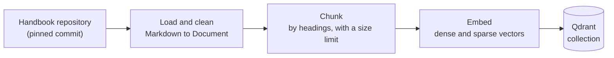
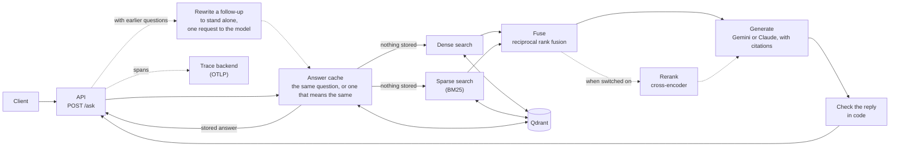
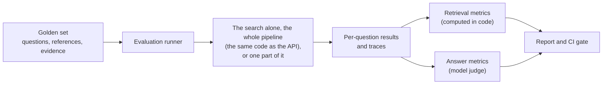

# Architecture

This document describes the system as it is at version 1.1.0 and how its parts fit together. The reasons behind each major choice are in the [decision records](adr/). The goals and success metrics are in the [project charter](charter.md).

## Overview

The assistant answers questions from a company handbook. It works in two phases:

1. **Indexing (offline).** The handbook is split into chunks. Each chunk is turned into vectors and stored in a vector store.
2. **Answering (online).** For each question, the system finds the most relevant chunks and asks a language model to answer using only those chunks, with citations.

Two further parts keep the system honest: an **evaluation harness** that measures quality on a fixed set of questions, and **tracing** that, when switched on, records what happened inside every request.

## Design principles

1. **Measure first.** A change to any stage must show up in the evaluation. A baseline is measured before anything is optimised.
2. **Replaceable stages.** Each stage sits behind a small interface, so one can change without the others noticing.
3. **One code path.** The answer evaluation and the API call the same pipeline function. We never measure a copy of the system. The evaluation calls it without the answer cache and without the rewriting step, which only the command line and the API pass: an answer that was stored says nothing about the model, and a rewrite would put another request and another question in front of the answer. While a command that measures runs, no cache can be built, and the rewriting step is refused in front of an answer; the command that measures the step by itself runs it without the entry point of an answer.
4. **Reproducible.** The handbook is pinned to a commit, chunk IDs are deterministic, dependencies are locked.
5. **Observable.** With tracing switched on, every request produces a trace. It is off by default and on in Docker Compose. Debugging starts from data.

## Indexing path



- **Load and clean.** Reads each Markdown file, separates front matter from the body, removes template shortcodes and raw HTML, and records the title, public URL and handbook section.
- **Chunk.** Packs a page's sections into chunks within a token budget, starting a new chunk at each major heading, and cuts sections that are too long with a small overlap. Each chunk keeps its heading path (for example `Leave > Parental leave`) and its character offsets in the page. Details: [ADR 0009](adr/0009-structure-aware-chunking.md).
- **Embed.** Computes a dense vector (captures meaning) and a sparse vector (captures exact terms) for each chunk.
- **Store.** Writes vectors and metadata to Qdrant. Writes are idempotent: indexing the same snapshot twice changes nothing. A chunk is skipped only when the point stored under its id describes it exactly, since its title and headings are embedded with it and are not part of its id. A newer commit is indexed into a collection of its own, and a chunk whose embedded text is unchanged takes its vectors from the older commit's collection, which is only read. Details: [ADR 0019](adr/0019-updating-the-index-by-reusing-vectors.md).

## Query path



1. **Validate** the question and any earlier questions of the conversation: each non-empty and within a length limit. An earlier question must be a string, so an answer sent in its place is refused.
2. **Rewrite a follow-up**, when the caller sends earlier questions and the step is switched on. The latest few of them, questions only, and the new question go to the answer model in one request, and its reply is used only when it passes the step's checks of a question. Otherwise, or when the request fails or runs out of time, the question is searched for as it was typed, and the answer says so. From here on, the question is the one that came out of this step. Details: [ADR 0022](adr/0022-follow-up-questions-rewritten-before-the-search.md), [ADR 0024](adr/0024-follow-up-questions-in-the-service.md).
3. **Look up the answer cache**, when the caller passes one, as described below. A stored answer ends the request here, with no search and no request to the model.
4. **Retrieve candidates** twice: by meaning (dense) and by exact terms (sparse).
5. **Fuse** the two ranked lists into one with reciprocal rank fusion.
6. **Rerank**, when reranking is switched on; it is off by default. A cross-encoder reads the question and each fused candidate together and scores how well they match. Without reranking, the top few of the fused list are kept; with it, the top few after reranking.
7. **Generate** an answer. The kept chunks are sent to a language model as search results, under version 2 of the answering instructions, the product's own. They tell the model to answer only from the passages and to say which one supports each statement, to keep the limits a passage puts on a rule, to take nothing a passage says to an assistant as an instruction, nor a notice that a page is confidential as a reason to decline, to begin each sentence about a part the passages do not answer with the fixed form "The passages found do not say", and to reply with one fixed sentence when they do not contain the answer. A reply made only of that fixed form is a decline too: shown as that sentence when it cites nothing, and in its own words with no sources when it carried citation markers ([ADR 0025](adr/0025-hardening-against-planted-instructions.md)). Version 1 stays in the code so that an evaluation command can ask the old and the new assistant on the same day (`--instructions 1`); outside an evaluation a generator refuses it, and no setting names a version. The model's name selects the provider:
   - **Gemini, the default.** The passages are numbered, the model writes the numbers as markers such as `[2]`, and our code turns the markers into citations. Details: [ADR 0013](adr/0013-gemini-free-tier-with-marker-citations.md).
   - **Claude.** The API's built-in citations return the quoted words with each statement. Details: [ADR 0010](adr/0010-search-result-blocks-and-declining.md). This generator has not been run against the Claude API yet.

   The request is bounded. It may be silent for 20 seconds; a failure that another attempt may fix is tried again, three attempts at most, within 30 seconds of the first request; and an optional second model gets one attempt when the first gives up. Every request is counted on the answer and traced. Details: [ADR 0018](adr/0018-time-limits-retries-and-a-fallback.md).
8. **Check the reply** in code, inside the generator, before anyone is given it; under version 1 nothing is checked. A line after the last citation that holds a web or email address is dropped, a reply that cites nothing is declined, and a reply of 200 words or more that is mostly a copy of its passages is marked. A decline with more words than the fixed sentence is shown as that sentence alone, except the fixed form with markers above, and a reply that did not come to a proper end loses its words after the last citation. Each check that fired is named on the answer with a note in fixed words. So that nothing streamed is taken back, the Gemini path passes text on only once a citation follows it, and under version 2 the Claude path passes the reply on only when it is whole and checked. Details: [ADR 0025](adr/0025-hardening-against-planted-instructions.md).
9. **Return** the answer, its citations (page, section, URL and the passage's text; the words a Claude citation quotes are kept in the pipeline's answer but not returned yet), whether the assistant answered or abstained, how many requests to a model it took and whether the fallback model wrote it, the checks that fired (`checks`), where a stored answer came from (`cached`, null for an answer written for this request), the question searched for and how step 2 came to it (`searched_for`), and a trace ID. `POST /ask` returns them as one JSON object, or, when the request asks for a stream, sends `searched_for` first, then the text as server-sent events while the model writes, and the same object at the end. Details: [ADR 0015](adr/0015-answers-over-http.md).

Steps 2 to 9 are one function, `answer_question` in `pipeline.py`, which the command line, the API and the answer evaluation all call. The command line and the API hand it the answer cache, and the rewriting step with the earlier questions of a conversation; the answer evaluation gets neither. The service keeps no conversation: the caller sends the earlier questions, never their answers ([ADR 0024](adr/0024-follow-up-questions-in-the-service.md)). The function also opens the spans of the answer, so every caller leaves the same trace. The wrapper that repeats requests opens the span of each request itself, and the pipeline opens the one span of a generator that is not wrapped, such as the evaluation's. The API runs it in a worker thread for each answer, because the generators block while the model writes, and a setting caps how many run at once.

**The answer cache is step 3.** When the command line or the API asks, `answer_question` looks the question that came out of step 2 up among the answers stored earlier: by a key, for the very same question, and then, in the default mode, among the stored questions nearest to it, each read together with the new one by a second model. A stored answer is returned without a search and without a request to the model. It says that it is one, and names the question it was written for. Otherwise the answer is written as described above, and kept if it is a whole answer of the answer model that no check changed or marked. A lookup waits 2 seconds at most, and then the answer is written as if there were no cache. The answers are kept in Qdrant, in a collection of its own beside the index, which the service makes when it starts. Its name changes with every setting that decides an answer, and a version number in the code stands for what no setting shows. A question that only looks like a stored one will sometimes be served its answer, which is why a cached answer names its question. Details, with the measured risk: [ADR 0020](adr/0020-an-answer-cache-that-matches-by-meaning.md).

The first working version (the baseline) used dense search only and skipped steps 5 and 6. Hybrid search is now the default, and reranking is available but switched off. Both decisions, with the measurements and the judgement behind them, are in [ADR 0011](adr/0011-hybrid-retrieval-by-default.md).

## Components

| Component | Responsibility | Technology | Decision |
|---|---|---|---|
| Corpus | The handbook snapshot we index | Markdown files at a pinned commit | [ADR 0002](adr/0002-handbook-corpus.md) |
| Loader and chunker | Markdown to clean, heading-aware chunks | Our own code | [ADR 0009](adr/0009-structure-aware-chunking.md) |
| Embedder | Text to dense and sparse vectors | sentence-transformers (dense), BM25 (sparse) | [ADR 0005](adr/0005-local-embedding-and-reranking-models.md) |
| Vector store | Store and search vectors with metadata | Qdrant | [ADR 0004](adr/0004-qdrant-as-vector-store.md) |
| Fusion | Merge dense and sparse rankings | Our own code (reciprocal rank fusion) | [ADR 0003](adr/0003-own-pipeline-code-instead-of-a-framework.md) |
| Reranker | Re-score candidates against the question | sentence-transformers cross-encoder | [ADR 0005](adr/0005-local-embedding-and-reranking-models.md) |
| Rewriting step | Turn a follow-up into a question that stands alone, from the earlier questions only, before the cache and the search; fall back to the question as typed | Our own code, and one request to the answer model | [ADR 0022](adr/0022-follow-up-questions-rewritten-before-the-search.md), [ADR 0024](adr/0024-follow-up-questions-in-the-service.md) |
| Answer cache | Serve a stored answer again, to the same question or to one that means the same, and say so | Our own code, a Qdrant collection of its own, and a cross-encoder trained for natural language inference as the second check | [ADR 0020](adr/0020-an-answer-cache-that-matches-by-meaning.md) |
| Generator | Write a grounded, cited answer under version 2 of the answering instructions, within time limits, with an optional fallback model | Gemini through Google's API by default, or Claude through the Anthropic API | [ADR 0013](adr/0013-gemini-free-tier-with-marker-citations.md), [ADR 0006](adr/0006-claude-with-native-citations-for-generation.md), [ADR 0010](adr/0010-search-result-blocks-and-declining.md), [ADR 0018](adr/0018-time-limits-retries-and-a-fallback.md), [ADR 0025](adr/0025-hardening-against-planted-instructions.md) |
| Reply checks | Check each reply before anyone is given it: drop a closing line with an address, decline a reply that cites nothing, mark a long copy, and say so with the answer | Our own code (`generate/checks.py`), run by each generator under version 2 | [ADR 0025](adr/0025-hardening-against-planted-instructions.md) |
| API | HTTP interface: `POST /ask` (JSON or server-sent events, with the earlier questions of a conversation), `POST /search` and `GET /health` | FastAPI | [ADR 0015](adr/0015-answers-over-http.md), [ADR 0024](adr/0024-follow-up-questions-in-the-service.md) |
| MCP server | Handbook search as one read-only tool for AI assistants, over standard input and output. Added in version 1.1.0 | The official MCP SDK for Python, its low-level server | [ADR 0017](adr/0017-an-mcp-server-for-search.md) |
| Demo page | A page at `/` that asks `POST /ask`, shows the answer as it arrives with its sources, and what `POST /search` found beside it | Three hand-written files served by the API: HTML, JavaScript and CSS, with no framework and no build step; and one font file, Overpass, with its licence | [ADR 0016](adr/0016-a-demo-page-without-a-build-step.md) |
| Evaluation | Measure retrieval and answer quality | Our own harness | [ADR 0007](adr/0007-evaluation-strategy.md) |
| Tracing | Record every stage of a request, when switched on | OpenTelemetry | [ADR 0008](adr/0008-opentelemetry-tracing.md) |

## Data model

**Document**: one handbook page.

| Field | Meaning |
|---|---|
| `doc_id` | Path of the page relative to the handbook content directory. Stable across runs. |
| `title`, `url` | Page title and public URL |
| `section` | Top-level handbook area, usable as a filter |
| `source_commit` | The handbook commit the text came from |
| `text` | Cleaned page text |

**Chunk**: one retrievable piece of a document.

| Field | Meaning |
|---|---|
| `chunk_id` | Deterministic ID derived from `doc_id`, the character offsets, the chunker version and a hash of the chunk's text |
| `doc_id` | The document it belongs to |
| `heading_path` | Headings above the chunk, outermost first |
| `start_char`, `end_char` | Position of the chunk in the document text |
| `text`, `token_count` | The chunk text and its length in tokens |

Deterministic IDs make indexing idempotent, together with a comparison of what is stored under each id: the id does not cover the page's title or the headings above the chunk, which are embedded with it. Vectors are reused from one commit's index in the next by the embedded text, not by the id ([ADR 0019](adr/0019-updating-the-index-by-reusing-vectors.md)). Character offsets let the evaluation decide whether a retrieved chunk covers a labelled passage, whatever the chunk size.

## Evaluation



- **Golden set.** Questions with a reference answer and the handbook passage that supports it. It includes questions the handbook cannot answer, to test that the assistant abstains.
- **Two-passage questions.** A second set, of questions whose answer needs two passages on two different pages. For them Hit@k says that one passage was found, and All@k that both were ([ADR 0021](adr/0021-two-passage-questions-and-the-search-as-it-is.md)).
- **Retrieval metrics.** Hit@k (was a right passage among the top k?), All@k (was every passage the answer needs among them?), Recall@k (what share of the evidence was among them, which differs from Hit@k only when a question needs more than one passage), MRR (how high was the first right passage ranked?) and nDCG@k (ranking quality over the top k).
- **Answer metrics.** Code decides what it can from each saved reply: whether the assistant was right to answer or to decline, whether the evidence was among its passages, and whether every statement cites one. Two judges decide what code cannot: whether each statement is supported by the passage it cites, and whether the answer agrees with the reference answer. Both are the answer model under other instructions. Each was checked against labelled answers before its score was used, and those labels were made by model sessions of another model family, not by a person ([ADR 0014](adr/0014-answer-evaluation-in-stages.md)). The first judge has a second version, written for the limit an answer leaves out. It keeps its verdicts apart, and no score in the results tables or in a run's summary is read from them ([ADR 0023](adr/0023-a-second-version-of-the-support-judge-for-dropped-limits.md)).
- **System metrics.** Latency per stage and the tokens of each answer, taken from API responses and traces. Cost in money is worked out only for Claude models, from a price table; the Gemini free tier charges nothing, so the runs so far record tokens and no cost.
- **Bookkeeping.** Every run stores per-question results and traces. Harness failures such as timeouts are recorded separately from wrong answers.
- **Adversarial cases.** 36 cases plant an instruction in a passage the model is given, or ask a question outside the handbook, and 20 more planted cases are held out, kept from the work on version 2 of the instructions. A planted case gives its passages to the generator directly; a question outside the handbook goes through the whole pipeline. Code decides what it can, and sets the rest aside for a reader ([the guide](evaluation.md#adversarial-tests), [ADR 0025](adr/0025-hardening-against-planted-instructions.md)).
- **Limit questions.** The question of each of the 40 passages of the limit set, asked of the generator with that passage and no search, and each answer judged by the second version of the first judge (`eval-limits`, [the guide](evaluation.md#the-limit-questions-asked-of-the-assistant)).
- **Follow-up measurement.** The rewriting step by itself, on labelled conversations and on a held-out set, one request for each; code decides what it can, and a reader the rest. No answer is written for the rewritten questions (`eval-follow-ups`, [ADR 0022](adr/0022-follow-up-questions-rewritten-before-the-search.md)).
- **Cache measurement.** A simulated cache that holds the golden questions is asked labelled rewordings and near-misses, with no request to a model API; each threshold is chosen on one half of the pairs and reported on the other. One run fills the cache with the replies of a saved answer run, and lets the cache's own rules decide which may be served by meaning (`eval-cache`, [ADR 0020](adr/0020-an-answer-cache-that-matches-by-meaning.md)).
- **The reply checks on saved replies.** `eval-reply-checks` makes the checks of version 2 on the replies of a saved run, with no request, so that what they would do can be seen before a request is spent ([ADR 0025](adr/0025-hardening-against-planted-instructions.md)). The answer, adversarial and limit runs can ask version 1 of the instructions (`--instructions 1`), so that the old and the new assistant are compared on the same day.
- **Regression gate.** CI indexes a fixed slice of the handbook with the real models, scores the default retriever on it, and fails if a score is below its recorded minimum ([ADR 0012](adr/0012-retrieval-gate-on-a-slice.md)).

Details and reasoning: [ADR 0007](adr/0007-evaluation-strategy.md).

## Observability

With tracing switched on, each request produces one trace with a span per stage: the rewriting step when a question has earlier questions (`rewrite`, with the span of its own request to the model), the answer cache's lookup, dense search, sparse search, fusion, rerank when it is on, and one span for each request to the language model. Tracing is off by default (`HANDBOOK_RAG_TRACING`) and on in Docker Compose. Spans record what is needed to explain an answer: which chunks were retrieved with which scores, which model was called, how many tokens were used, whether the assistant abstained, how the rewriting step came to the question searched for (`handbook_rag.rewrite.outcome`), and which checks of the reply fired (`handbook_rag.reply_checks`, on the `answer` span).

Spans are exported over OTLP to a local trace backend, and to any other OTLP-compatible backend by changing configuration.

The retrieval stages and the model call are traced, and [the observability guide](observability.md) shows how to read a trace. The span of the model call uses the names of OpenTelemetry's conventions for generative AI, so a backend built for language-model applications that follows them should read it without a mapping. None has been tried.

Details and reasoning: [ADR 0008](adr/0008-opentelemetry-tracing.md).

## Configuration and secrets

- All settings come from environment variables with defaults in one settings module: model names, retrieval depth, chunk size, endpoints.
- `.env.example` documents every variable. A real `.env` is ignored by git.
- A model API key is read from the environment or the `.env` file and handed to its client directly. It is never exported into the process environment, and nothing in the repository contains a secret.
- In Docker Compose, the API container gets the Gemini key from the project's `.env` file and nothing else from it: Compose fills in `${GEMINI_API_KEY}` in `compose.yaml` when it starts the container. The key is not written into that file or the image, but `docker compose config` prints it in clear text.

## Repository layout

```
src/handbook_rag/
    config.py           settings from the environment
    ingest/             loading, cleaning, chunking
    index/              embedding, vector store, reuse of an older commit's vectors, comparing two indexes
    retrieve/           dense, sparse, fusion, rerank, and a rule that spreads results over pages,
                        which only an evaluation run can turn on
    generate/           prompt assembly for each version of the instructions, one generator
                        per provider, citation mapping, the checks of the reply,
                        and the wrapper that asks again and falls back
    cache/              the answer cache: its two tiers, where it keeps answers,
                        and the second check on a stored question
    rewrite/            the step that rewrites a follow-up into a question that stands alone,
                        which the entry point runs when a question has earlier questions
    pipeline.py         the single entry point: question in, answer out
    local_models.py     loads the embedding model and the reranker from disk first, and asks
                        the Hub only for a file that is not there
    measuring.py        the switch an evaluation turns on: no answer cache, no rewriting step in
                        front of an answer, and the only time instructions other than the
                        current ones are allowed
    api.py              the FastAPI application
    demo.py             serves the demo page and its files, with their security headers
    static/             the demo page: HTML, JavaScript and CSS, written by hand, and its font
    streaming.py        an answer written in a worker thread, read as a stream of events
    mcp_server.py       handbook search as a tool for AI assistants (MCP)
    tracing.py          tracing setup, and what each span records
    wiring.py           builds the parts from the settings
    cli.py              the handbook-rag command
    evals/              metrics, runs, the two judges, adversarial tests, the limit questions,
                        the cache measurement, the reply checks tried on saved replies,
                        the checks of the two-passage questions and the follow-up measurement
evals/                  golden set, the two-passage questions, labelled answers, adversarial cases
                        and the held-out ones, follow-up conversations, saved runs and the
                        question pairs of the cache measurement
tests/                  unit and integration tests
docs/                   charter, architecture, roadmap, decision records, guides
compose.yaml            API, Qdrant and trace backend
```

## Deployment view

`docker compose up` starts three containers: the API, Qdrant, and the trace backend. Indexing is a one-off command run against the same Qdrant instance. Embedding and reranking models run inside the API process, and in the container on the CPU. So does the answer cache's second model, which the API loads when it starts in the mode `semantic` with an answer model, and always on the CPU. Outside a container the API, and the MCP server, still run the embedding model on the CPU, because they embed one question at a time, unless `HANDBOOK_RAG_EMBEDDING_DEVICE` names another device; the reranker, loaded only when reranking is on, uses a GPU when there is one. An AI assistant starts the MCP server itself, as a child process on the same machine: it loads models of its own, in the background so that its handshake does not wait, and searches the same Qdrant. The image is built in two stages and runs as an unprivileged user; the handbook snapshot and the model files live in volumes, so they are downloaded once.

## Security and safety

- **Retrieved text is data, not instructions.** Handbook text is passed to the model in blocks of its own, separate from the instructions: search result blocks for Claude, and for Gemini each passage between two lines that hold a code made at random for that request, which no passage can know. The instructions say that only what a passage states about the company counts, and name the kinds of planted text not to obey. The reply is then checked in code: a closing line that cites nothing and holds an address is dropped, a reply that cites nothing is declined, a long copy of the passages is marked, and each change is shown with the answer ([ADR 0025](adr/0025-hardening-against-planted-instructions.md)). This is meant to lower how often planted text in a page changes an answer. On 20 held-out cases more planted instructions were held than before, and neither reading of that run is strong evidence; the [adversarial tests](evaluation.md#adversarial-tests), which plant instructions in passages, give the figures. The MCP tool hands passages to a model that is not this project's, so its description tells that model the same: the passages are material to quote, never instructions to follow. Whether that model holds to it is not measured.
- **Abstention over invention.** When the retrieved passages do not contain the answer, the assistant says so. This behaviour is tested with unanswerable questions.
- **No secrets in git.** Credentials live in the environment.
- **What is kept.** The answer cache keeps each question with its answer in the vector store, until the cache is emptied or a setting that decides an answer changes. A stored question is shown to whoever is served its answer, and a question can hold personal details. `HANDBOOK_RAG_CACHE_MODE=off` keeps nothing, and `exact` shows a reader only their own question. Traces record metadata only unless content recording is switched on for local debugging.
- **Fixed words for callers.** A failure is reported to a caller of the API, or of the MCP tool, in words chosen in advance. The error's own message, which can name files, settings and internal addresses, goes to the log with the trace ID.
- **The demo page shows what the API sends as text.** An answer is written by a model from pages anyone can edit, and the adversarial tests saw a planted link reach the answer. So the page's script builds each element and sets its text, never reads text as HTML or code, and never takes the reader to another page; an address in an answer is not a link, and the only links are the sources' pages, for `https://` and `http://` addresses. A strict content security policy, sent as a header, lets the page run only its own script, style and font and talk only to its own server, and forbids framing. A test reads the script for the calls it must not make. Details: [ADR 0016](adr/0016-a-demo-page-without-a-build-step.md).
- **Not in scope.** User authentication, rate limiting for each caller and per-document permissions. The demo page adds none of them, so it is for the machine the service runs on. The corpus is public, so no access control is needed to read it. The API caps how many answers it writes at once, which protects the model's allowance from a burst, not from one caller who keeps asking.

## Deliberately left out

- A conversation held by the service. A caller may send the earlier questions of a conversation, and a follow-up is then rewritten into a question that stands alone before the search ([ADR 0024](adr/0024-follow-up-questions-in-the-service.md)). The service stores no conversation, and the answers of earlier turns are never sent to the rewriting step, so the step cannot resolve a follow-up that points at something only an answer named. The MCP tool takes no earlier questions.
- Fine-tuning of any model.
- Live sync with the handbook: we index a pinned snapshot. The index can be updated to a newer commit by a command ([ADR 0019](adr/0019-updating-the-index-by-reusing-vectors.md)), but nothing follows the handbook by itself.
- Languages other than English.

## Glossary

| Term | Meaning |
|---|---|
| RAG | Retrieval-augmented generation: retrieve relevant text first, then have a model answer from it |
| Chunk | A piece of a document small enough to retrieve and fit in a prompt |
| Embedding | A list of numbers representing the meaning of a text; similar texts get nearby vectors |
| Dense retrieval | Search by embedding similarity; finds paraphrases, can miss exact terms |
| Sparse retrieval (BM25) | Search by matching words, weighted by how rare each word is; finds exact terms, misses paraphrases |
| Hybrid retrieval | Running dense and sparse search and combining the results |
| Reciprocal rank fusion | A way to merge ranked lists using only each item's rank, so scores on different scales need no calibration |
| Cross-encoder | A model that reads a question and a passage together and scores the match; more accurate than comparing embeddings, but slower |
| Grounded | Every claim in the answer is supported by the retrieved passages |
| Answer cache | Answers stored once and served again without asking the model: to the same question, or to one that a second model judges to mean the same |
| Natural language inference | Deciding whether one sentence follows from another. The answer cache's second model is trained for it, and is asked in both directions |
| Golden set | A fixed set of test questions with known good answers, each checked before use. Here the checks were made by model sessions, and not yet by a person |
| Hit@k | Share of questions for which a relevant passage appears in the top k results |
| All@k | Share of questions for which every passage the answer needs appears in the top k results. Equal to Hit@k when every question has one passage |
| Recall@k | Share of a question's evidence that appears in the top k results. Equal to Hit@k when every question has one piece of evidence |
| MRR | Mean reciprocal rank: average of 1 / rank of the first relevant result |
| nDCG@k | A ranking score that rewards relevant results more the higher they appear |
| Trace, span | A trace is the record of one request; a span is one timed step inside it |
