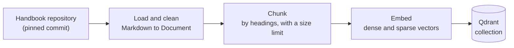
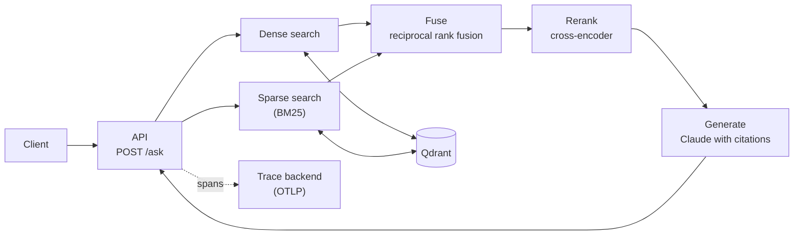
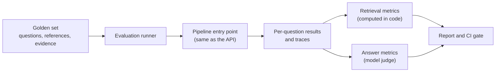

# Architecture

This document describes the system we are building and how its parts fit together. The reasons behind each major choice are in the [decision records](adr/). The goals and success metrics are in the [project charter](charter.md).

## Overview

The assistant answers questions from a company handbook. It works in two phases:

1. **Indexing (offline).** The handbook is split into chunks. Each chunk is turned into vectors and stored in a vector store.
2. **Answering (online).** For each question, the system finds the most relevant chunks and asks a language model to answer using only those chunks, with citations.

Two further parts keep the system honest: an **evaluation harness** that measures quality on a fixed set of questions, and **tracing** that records what happened inside every request.

## Design principles

1. **Measure first.** A change to any stage must show up in the evaluation. A baseline is measured before anything is optimised.
2. **Replaceable stages.** Each stage sits behind a small interface, so one can change without the others noticing.
3. **One code path.** The evaluation and the API call the same pipeline function. We never measure a copy of the system.
4. **Reproducible.** The handbook is pinned to a commit, chunk IDs are deterministic, dependencies are locked.
5. **Observable by default.** Every request produces a trace. Debugging starts from data.

## Indexing path



- **Load and clean.** Reads each Markdown file, separates front matter from the body, removes template shortcodes and raw HTML, and records the title, public URL and handbook section.
- **Chunk.** Packs a page's sections into chunks within a token budget, starting a new chunk at each major heading, and cuts sections that are too long with a small overlap. Each chunk keeps its heading path (for example `Leave > Parental leave`) and its character offsets in the page. Details: [ADR 0009](adr/0009-structure-aware-chunking.md).
- **Embed.** Computes a dense vector (captures meaning) and a sparse vector (captures exact terms) for each chunk.
- **Store.** Writes vectors and metadata to Qdrant. Writes are idempotent: indexing the same snapshot twice changes nothing.

## Query path



1. **Validate** the question (non-empty, within a length limit).
2. **Retrieve candidates** twice: by meaning (dense) and by exact terms (sparse).
3. **Fuse** the two ranked lists into one with reciprocal rank fusion.
4. **Rerank** the fused candidates with a cross-encoder, which reads the question and each chunk together and scores how well they match. Keep the top few.
5. **Generate** an answer. The kept chunks are sent to Claude as search results with citations enabled. The instructions tell the model to answer only from them, and to reply with one fixed sentence when they do not contain the answer. Details: [ADR 0010](adr/0010-search-result-blocks-and-declining.md).
6. **Return** the answer, its citations (page, section, quoted text, URL), whether the assistant answered or abstained, and a trace ID.

The first working version (the baseline) used dense search only and skipped steps 3 and 4. Hybrid search is now the default, and reranking is available but switched off. Both decisions, with the measurements and the judgement behind them, are in [ADR 0011](adr/0011-hybrid-retrieval-by-default.md).

## Components

| Component | Responsibility | Technology | Decision |
|---|---|---|---|
| Corpus | The handbook snapshot we index | Markdown files at a pinned commit | [ADR 0002](adr/0002-handbook-corpus.md) |
| Loader and chunker | Markdown to clean, heading-aware chunks | Our own code | [ADR 0009](adr/0009-structure-aware-chunking.md) |
| Embedder | Text to dense and sparse vectors | sentence-transformers (dense), BM25 (sparse) | [ADR 0005](adr/0005-local-embedding-and-reranking-models.md) |
| Vector store | Store and search vectors with metadata | Qdrant | [ADR 0004](adr/0004-qdrant-as-vector-store.md) |
| Fusion | Merge dense and sparse rankings | Our own code (reciprocal rank fusion) | [ADR 0003](adr/0003-own-pipeline-code-instead-of-a-framework.md) |
| Reranker | Re-score candidates against the question | sentence-transformers cross-encoder | [ADR 0005](adr/0005-local-embedding-and-reranking-models.md) |
| Generator | Write a grounded, cited answer | Claude through the Anthropic API | [ADR 0006](adr/0006-claude-with-native-citations-for-generation.md), [ADR 0010](adr/0010-search-result-blocks-and-declining.md) |
| API | HTTP interface: `POST /search` and `GET /health` today, `POST /ask` with streaming when the answering step lands | FastAPI | This document |
| Evaluation | Measure retrieval and answer quality | Our own harness | [ADR 0007](adr/0007-evaluation-strategy.md) |
| Tracing | Record every stage of every request | OpenTelemetry | [ADR 0008](adr/0008-opentelemetry-tracing.md) |

## Data model

**Document**: one handbook page.

| Field | Meaning |
|---|---|
| `doc_id` | Path of the page relative to the handbook content directory. Stable across runs. |
| `title`, `url` | Page title and public URL |
| `section` | Top-level handbook area, usable as a filter |
| `source_commit` | The handbook commit the text came from |
| `text` | Cleaned page text |

**Chunk**: one retrievable piece of a document.

| Field | Meaning |
|---|---|
| `chunk_id` | Deterministic ID derived from `doc_id`, the character offsets and the chunker version |
| `doc_id` | The document it belongs to |
| `heading_path` | Headings above the chunk, outermost first |
| `start_char`, `end_char` | Position of the chunk in the document text |
| `text`, `token_count` | The chunk text and its length in tokens |

Deterministic IDs make indexing idempotent. Character offsets let the evaluation decide whether a retrieved chunk covers a labelled passage, whatever the chunk size.

## Evaluation



- **Golden set.** Questions with a reference answer and the handbook passage that supports it. It includes questions the handbook cannot answer, to test that the assistant abstains.
- **Retrieval metrics.** Recall@k (was the right passage in the top k?), MRR (how high was it ranked?) and nDCG@k (ranking quality over the top k).
- **Answer metrics.** A judge model checks each answer against separate criteria: supported by the cited passages, consistent with the reference answer, and correct to answer or abstain. The judge is validated against human labels before its scores are used.
- **System metrics.** Latency per stage, tokens and cost per answer, taken from API responses and traces.
- **Bookkeeping.** Every run stores per-question results and traces. Harness failures such as timeouts are recorded separately from wrong answers.
- **Regression gate.** CI indexes a fixed slice of the handbook with the real models, scores the default retriever on it, and fails if a score is below its recorded minimum ([ADR 0012](adr/0012-retrieval-gate-on-a-slice.md)).

Details and reasoning: [ADR 0007](adr/0007-evaluation-strategy.md).

## Observability

Each request produces one trace with a span per stage: dense search, sparse search, fusion, rerank, generate. Spans record what is needed to explain an answer: which chunks were retrieved with which scores, which model was called, how many tokens were used, and whether the assistant abstained.

The Anthropic SDK adds its own spans for the model call, including token usage. Spans are exported over OTLP to a local trace backend, and to any other OTLP-compatible backend by changing configuration.

The retrieval stages are traced today, and [the observability guide](observability.md) shows how to read a trace. The model call is traced when the answering step lands.

Details and reasoning: [ADR 0008](adr/0008-opentelemetry-tracing.md).

## Configuration and secrets

- All settings come from environment variables with defaults in one settings module: model names, retrieval depth, chunk size, endpoints.
- `.env.example` documents every variable. A real `.env` is ignored by git.
- The Claude API credential is read from the environment by the SDK. Nothing in the repository contains a secret.

## Repository layout (planned)

```
src/handbook_rag/
    config.py           settings from the environment
    ingest/             loading, cleaning, chunking
    index/              embedding and vector store
    retrieve/           dense, sparse, fusion, rerank
    generate/           prompt assembly, Claude client, citation mapping
    pipeline.py         the single entry point: question in, answer out
    api/                FastAPI application
    observability/      tracing setup
evals/                  golden set, runner, metrics, judge
tests/                  unit and integration tests
docs/                   charter, architecture, roadmap, decision records
compose.yaml            API, Qdrant and trace backend
```

## Deployment view

`docker compose up` starts three containers: the API, Qdrant, and the trace backend. Indexing is a one-off command run against the same Qdrant instance. Embedding and reranking models run inside the API process: on CPU in the container, and on a GPU when one is available. The image is built in two stages and runs as an unprivileged user; the handbook snapshot and the model files live in volumes, so they are downloaded once.

## Security and safety

- **Retrieved text is data, not instructions.** Handbook text is passed to the model as search result blocks, separate from the instructions, and the instructions say to treat anything inside them as content, never as commands. This limits prompt injection through corpus content.
- **Abstention over invention.** When the retrieved passages do not contain the answer, the assistant says so. This behaviour is tested with unanswerable questions.
- **No secrets in git.** Credentials live in the environment.
- **Minimal data retention.** Questions and answers are not stored outside traces, and traces record metadata only unless content recording is switched on for local debugging.
- **Not in scope for the first version.** User authentication, rate limiting and per-document permissions. The corpus is public, so no access control is needed to read it.

## Deliberately left out

- Multi-turn conversation: each question is answered independently.
- Fine-tuning of any model.
- Live sync with the handbook: we index a pinned snapshot.
- Languages other than English.

## Glossary

| Term | Meaning |
|---|---|
| RAG | Retrieval-augmented generation: retrieve relevant text first, then have a model answer from it |
| Chunk | A piece of a document small enough to retrieve and fit in a prompt |
| Embedding | A list of numbers representing the meaning of a text; similar texts get nearby vectors |
| Dense retrieval | Search by embedding similarity; finds paraphrases, can miss exact terms |
| Sparse retrieval (BM25) | Search by matching words, weighted by how rare each word is; finds exact terms, misses paraphrases |
| Hybrid retrieval | Running dense and sparse search and combining the results |
| Reciprocal rank fusion | A way to merge ranked lists using only each item's rank, so scores on different scales need no calibration |
| Cross-encoder | A model that reads a question and a passage together and scores the match; more accurate than comparing embeddings, but slower |
| Grounded | Every claim in the answer is supported by the retrieved passages |
| Golden set | A fixed, reviewed set of test questions with known good answers |
| Recall@k | Share of questions for which a relevant passage appears in the top k results |
| MRR | Mean reciprocal rank: average of 1 / rank of the first relevant result |
| nDCG@k | A ranking score that rewards relevant results more the higher they appear |
| Trace, span | A trace is the record of one request; a span is one timed step inside it |
