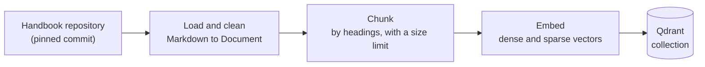
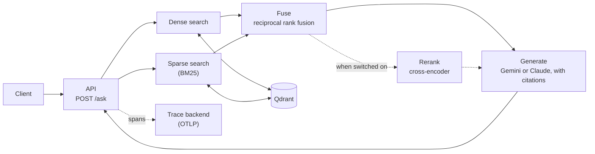
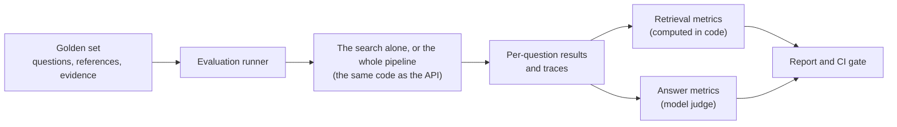

# Architecture

This document describes the system as it is at version 1.0.0 and how its parts fit together. The reasons behind each major choice are in the [decision records](adr/). The goals and success metrics are in the [project charter](charter.md).

## Overview

The assistant answers questions from a company handbook. It works in two phases:

1. **Indexing (offline).** The handbook is split into chunks. Each chunk is turned into vectors and stored in a vector store.
2. **Answering (online).** For each question, the system finds the most relevant chunks and asks a language model to answer using only those chunks, with citations.

Two further parts keep the system honest: an **evaluation harness** that measures quality on a fixed set of questions, and **tracing** that, when switched on, records what happened inside every request.

## Design principles

1. **Measure first.** A change to any stage must show up in the evaluation. A baseline is measured before anything is optimised.
2. **Replaceable stages.** Each stage sits behind a small interface, so one can change without the others noticing.
3. **One code path.** The answer evaluation and the API call the same pipeline function. We never measure a copy of the system.
4. **Reproducible.** The handbook is pinned to a commit, chunk IDs are deterministic, dependencies are locked.
5. **Observable.** With tracing switched on, every request produces a trace. It is off by default and on in Docker Compose. Debugging starts from data.

## Indexing path



- **Load and clean.** Reads each Markdown file, separates front matter from the body, removes template shortcodes and raw HTML, and records the title, public URL and handbook section.
- **Chunk.** Packs a page's sections into chunks within a token budget, starting a new chunk at each major heading, and cuts sections that are too long with a small overlap. Each chunk keeps its heading path (for example `Leave > Parental leave`) and its character offsets in the page. Details: [ADR 0009](adr/0009-structure-aware-chunking.md).
- **Embed.** Computes a dense vector (captures meaning) and a sparse vector (captures exact terms) for each chunk.
- **Store.** Writes vectors and metadata to Qdrant. Writes are idempotent: indexing the same snapshot twice changes nothing. A chunk is skipped only when the point stored under its id describes it exactly, since its title and headings are embedded with it and are not part of its id. A newer commit is indexed into a collection of its own, and a chunk whose embedded text is unchanged takes its vectors from the older commit's collection, which is only read. Details: [ADR 0019](adr/0019-updating-the-index-by-reusing-vectors.md).

## Query path



1. **Validate** the question (non-empty, within a length limit).
2. **Retrieve candidates** twice: by meaning (dense) and by exact terms (sparse).
3. **Fuse** the two ranked lists into one with reciprocal rank fusion.
4. **Rerank**, when reranking is switched on; it is off by default. A cross-encoder reads the question and each fused candidate together and scores how well they match. Without reranking, the top few of the fused list are kept; with it, the top few after reranking.
5. **Generate** an answer. The kept chunks are sent to a language model as search results. The instructions tell the model to answer only from them, to say which search result supports each statement, and to reply with one fixed sentence when they do not contain the answer. The model's name selects the provider:
   - **Gemini, the default.** The passages are numbered, the model writes the numbers as markers such as `[2]`, and our code turns the markers into citations. Details: [ADR 0013](adr/0013-gemini-free-tier-with-marker-citations.md).
   - **Claude.** The API's built-in citations return the quoted words with each statement. Details: [ADR 0010](adr/0010-search-result-blocks-and-declining.md). This generator has not been run against the Claude API yet.

   The request is bounded. It may be silent for 20 seconds; a failure that another attempt may fix is tried again, three attempts at most, within 30 seconds of the first request; and an optional second model gets one attempt when the first gives up. Every request is counted on the answer and traced. Details: [ADR 0018](adr/0018-time-limits-retries-and-a-fallback.md).
6. **Return** the answer, its citations (page, section, URL and the passage's text; the words a Claude citation quotes are kept in the pipeline's answer but not returned yet), whether the assistant answered or abstained, how many requests to a model it took and whether the fallback model wrote it, and a trace ID. `POST /ask` returns them as one JSON object, or, when the request asks for a stream, sends the text as server-sent events while the model writes and the same object at the end. Details: [ADR 0015](adr/0015-answers-over-http.md).

Steps 2 to 6 are one function, `answer_question` in `pipeline.py`, which the command line, the API and the answer evaluation all call. It also opens the spans of the answer, so every caller leaves the same trace. The wrapper that repeats requests opens the span of each request itself, and the pipeline opens the one span of a generator that is not wrapped, such as the evaluation's. The API runs it in a worker thread for each answer, because the generators block while the model writes, and a setting caps how many run at once.

The first working version (the baseline) used dense search only and skipped steps 3 and 4. Hybrid search is now the default, and reranking is available but switched off. Both decisions, with the measurements and the judgement behind them, are in [ADR 0011](adr/0011-hybrid-retrieval-by-default.md).

## Components

| Component | Responsibility | Technology | Decision |
|---|---|---|---|
| Corpus | The handbook snapshot we index | Markdown files at a pinned commit | [ADR 0002](adr/0002-handbook-corpus.md) |
| Loader and chunker | Markdown to clean, heading-aware chunks | Our own code | [ADR 0009](adr/0009-structure-aware-chunking.md) |
| Embedder | Text to dense and sparse vectors | sentence-transformers (dense), BM25 (sparse) | [ADR 0005](adr/0005-local-embedding-and-reranking-models.md) |
| Vector store | Store and search vectors with metadata | Qdrant | [ADR 0004](adr/0004-qdrant-as-vector-store.md) |
| Fusion | Merge dense and sparse rankings | Our own code (reciprocal rank fusion) | [ADR 0003](adr/0003-own-pipeline-code-instead-of-a-framework.md) |
| Reranker | Re-score candidates against the question | sentence-transformers cross-encoder | [ADR 0005](adr/0005-local-embedding-and-reranking-models.md) |
| Generator | Write a grounded, cited answer, within time limits, with an optional fallback model | Gemini through Google's API by default, or Claude through the Anthropic API | [ADR 0013](adr/0013-gemini-free-tier-with-marker-citations.md), [ADR 0006](adr/0006-claude-with-native-citations-for-generation.md), [ADR 0010](adr/0010-search-result-blocks-and-declining.md), [ADR 0018](adr/0018-time-limits-retries-and-a-fallback.md) |
| API | HTTP interface: `POST /ask` (JSON or server-sent events), `POST /search` and `GET /health` | FastAPI | [ADR 0015](adr/0015-answers-over-http.md) |
| MCP server | Handbook search as one read-only tool for AI assistants, over standard input and output. Added after version 1.0.0 | The official MCP SDK for Python, its low-level server | [ADR 0017](adr/0017-an-mcp-server-for-search.md) |
| Demo page | A page at `/` that asks `POST /ask`, shows the answer as it arrives with its sources, and what `POST /search` found beside it | Three hand-written files served by the API: HTML, JavaScript and CSS, with no framework and no build step | [ADR 0016](adr/0016-a-demo-page-without-a-build-step.md) |
| Evaluation | Measure retrieval and answer quality | Our own harness | [ADR 0007](adr/0007-evaluation-strategy.md) |
| Tracing | Record every stage of a request, when switched on | OpenTelemetry | [ADR 0008](adr/0008-opentelemetry-tracing.md) |

## Data model

**Document**: one handbook page.

| Field | Meaning |
|---|---|
| `doc_id` | Path of the page relative to the handbook content directory. Stable across runs. |
| `title`, `url` | Page title and public URL |
| `section` | Top-level handbook area, usable as a filter |
| `source_commit` | The handbook commit the text came from |
| `text` | Cleaned page text |

**Chunk**: one retrievable piece of a document.

| Field | Meaning |
|---|---|
| `chunk_id` | Deterministic ID derived from `doc_id`, the character offsets, the chunker version and a hash of the chunk's text |
| `doc_id` | The document it belongs to |
| `heading_path` | Headings above the chunk, outermost first |
| `start_char`, `end_char` | Position of the chunk in the document text |
| `text`, `token_count` | The chunk text and its length in tokens |

Deterministic IDs make indexing idempotent, together with a comparison of what is stored under each id: the id does not cover the page's title or the headings above the chunk, which are embedded with it. Vectors are reused from one commit's index in the next by the embedded text, not by the id ([ADR 0019](adr/0019-updating-the-index-by-reusing-vectors.md)). Character offsets let the evaluation decide whether a retrieved chunk covers a labelled passage, whatever the chunk size.

## Evaluation



- **Golden set.** Questions with a reference answer and the handbook passage that supports it. It includes questions the handbook cannot answer, to test that the assistant abstains.
- **Retrieval metrics.** Hit@k (was a right passage among the top k?), Recall@k (what share of the evidence was among them, which differs from Hit@k only when a question needs more than one passage), MRR (how high was the first right passage ranked?) and nDCG@k (ranking quality over the top k).
- **Answer metrics.** Code decides what it can from each saved reply: whether the assistant was right to answer or to decline, whether the evidence was among its passages, and whether every statement cites one. Two judges decide what code cannot: whether each statement is supported by the passage it cites, and whether the answer agrees with the reference answer. Both are the answer model under other instructions. Each was checked against labelled answers before its score was used, and those labels were made by model sessions of another model family, not by a person ([ADR 0014](adr/0014-answer-evaluation-in-stages.md)).
- **System metrics.** Latency per stage and the tokens of each answer, taken from API responses and traces. Cost in money is worked out only for Claude models, from a price table; the Gemini free tier charges nothing, so the runs so far record tokens and no cost.
- **Bookkeeping.** Every run stores per-question results and traces. Harness failures such as timeouts are recorded separately from wrong answers.
- **Regression gate.** CI indexes a fixed slice of the handbook with the real models, scores the default retriever on it, and fails if a score is below its recorded minimum ([ADR 0012](adr/0012-retrieval-gate-on-a-slice.md)).

Details and reasoning: [ADR 0007](adr/0007-evaluation-strategy.md).

## Observability

With tracing switched on, each request produces one trace with a span per stage: dense search, sparse search, fusion, rerank when it is on, and one span for each request to the language model. Tracing is off by default (`HANDBOOK_RAG_TRACING`) and on in Docker Compose. Spans record what is needed to explain an answer: which chunks were retrieved with which scores, which model was called, how many tokens were used, and whether the assistant abstained.

Spans are exported over OTLP to a local trace backend, and to any other OTLP-compatible backend by changing configuration.

The retrieval stages and the model call are traced, and [the observability guide](observability.md) shows how to read a trace. The span of the model call uses the names of OpenTelemetry's conventions for generative AI, so a backend built for language-model applications that follows them should read it without a mapping. None has been tried.

Details and reasoning: [ADR 0008](adr/0008-opentelemetry-tracing.md).

## Configuration and secrets

- All settings come from environment variables with defaults in one settings module: model names, retrieval depth, chunk size, endpoints.
- `.env.example` documents every variable. A real `.env` is ignored by git.
- A model API key is read from the environment or the `.env` file and handed to its client directly. It is never exported into the process environment, and nothing in the repository contains a secret.
- In Docker Compose, the API container gets the Gemini key from the project's `.env` file and nothing else from it: Compose fills in `${GEMINI_API_KEY}` in `compose.yaml` when it starts the container. The key is not written into that file or the image, but `docker compose config` prints it in clear text.

## Repository layout

```
src/handbook_rag/
    config.py           settings from the environment
    ingest/             loading, cleaning, chunking
    index/              embedding, vector store, reuse of an older commit's vectors, comparing two indexes
    retrieve/           dense, sparse, fusion, rerank
    generate/           prompt assembly, one generator per provider, citation mapping,
                        and the wrapper that asks again and falls back
    cache/              the second check a semantic cache would make; no cache is built yet
    pipeline.py         the single entry point: question in, answer out
    api.py              the FastAPI application
    demo.py             serves the demo page and its two files, with their security headers
    static/             the demo page: HTML, JavaScript and CSS, written by hand
    streaming.py        an answer written in a worker thread, read as a stream of events
    mcp_server.py       handbook search as a tool for AI assistants (MCP)
    tracing.py          tracing setup, and what each span records
    wiring.py           builds the parts from the settings
    cli.py              the handbook-rag command
    evals/              metrics, runs, the two judges, adversarial tests
                        and the cache measurement
evals/                  golden set, labelled answers, adversarial cases, saved runs
                        and the question pairs of the cache measurement
tests/                  unit and integration tests
docs/                   charter, architecture, roadmap, decision records, guides
compose.yaml            API, Qdrant and trace backend
```

## Deployment view

`docker compose up` starts three containers: the API, Qdrant, and the trace backend. Indexing is a one-off command run against the same Qdrant instance. Embedding and reranking models run inside the API process, and in the container on the CPU. Outside a container the API, and the MCP server, still run the embedding model on the CPU, because they embed one question at a time, unless `HANDBOOK_RAG_EMBEDDING_DEVICE` names another device; the reranker, loaded only when reranking is on, uses a GPU when there is one. An AI assistant starts the MCP server itself, as a child process on the same machine: it loads models of its own, in the background so that its handshake does not wait, and searches the same Qdrant. The image is built in two stages and runs as an unprivileged user; the handbook snapshot and the model files live in volumes, so they are downloaded once.

## Security and safety

- **Retrieved text is data, not instructions.** Handbook text is passed to the model in blocks of its own, separate from the instructions: search result blocks for Claude, tagged blocks for Gemini. The instructions say to treat anything inside them as content, never as commands. For Gemini, text in a passage that looks like one of the block's tags is made harmless first. This limits prompt injection through corpus content. How far it holds against the real model is measured by the [adversarial tests](evaluation.md#adversarial-tests), which plant instructions in passages. The MCP tool hands passages to a model that is not this project's, so its description tells that model the same: the passages are material to quote, never instructions to follow. Whether that model holds to it is not measured.
- **Abstention over invention.** When the retrieved passages do not contain the answer, the assistant says so. This behaviour is tested with unanswerable questions.
- **No secrets in git.** Credentials live in the environment.
- **Minimal data retention.** Questions and answers are not stored outside traces, and traces record metadata only unless content recording is switched on for local debugging.
- **Fixed words for callers.** A failure is reported to a caller of the API, or of the MCP tool, in words chosen in advance. The error's own message, which can name files, settings and internal addresses, goes to the log with the trace ID.
- **The demo page shows what the API sends as text.** An answer is written by a model from pages anyone can edit, and the adversarial tests saw a planted link reach the answer. So the page's script builds each element and sets its text, never reads text as HTML or code, and never takes the reader to another page; an address in an answer is not a link, and the only links are the sources' pages, for `https://` and `http://` addresses. A strict content security policy, sent as a header, lets the page run only its own script and style and talk only to its own server, and forbids framing. A test reads the script for the calls it must not make. Details: [ADR 0016](adr/0016-a-demo-page-without-a-build-step.md).
- **Not in scope for the first version.** User authentication, rate limiting for each caller and per-document permissions. The demo page adds none of them, so it is for the machine the service runs on. The corpus is public, so no access control is needed to read it. The API caps how many answers it writes at once, which protects the model's allowance from a burst, not from one caller who keeps asking.

## Deliberately left out

- Multi-turn conversation: each question is answered independently.
- Fine-tuning of any model.
- Live sync with the handbook: we index a pinned snapshot. The index can be updated to a newer commit by a command ([ADR 0019](adr/0019-updating-the-index-by-reusing-vectors.md)), but nothing follows the handbook by itself.
- Languages other than English.

## Glossary

| Term | Meaning |
|---|---|
| RAG | Retrieval-augmented generation: retrieve relevant text first, then have a model answer from it |
| Chunk | A piece of a document small enough to retrieve and fit in a prompt |
| Embedding | A list of numbers representing the meaning of a text; similar texts get nearby vectors |
| Dense retrieval | Search by embedding similarity; finds paraphrases, can miss exact terms |
| Sparse retrieval (BM25) | Search by matching words, weighted by how rare each word is; finds exact terms, misses paraphrases |
| Hybrid retrieval | Running dense and sparse search and combining the results |
| Reciprocal rank fusion | A way to merge ranked lists using only each item's rank, so scores on different scales need no calibration |
| Cross-encoder | A model that reads a question and a passage together and scores the match; more accurate than comparing embeddings, but slower |
| Grounded | Every claim in the answer is supported by the retrieved passages |
| Golden set | A fixed set of test questions with known good answers, each checked before use. Here the checks were made by model sessions, and not yet by a person |
| Hit@k | Share of questions for which a relevant passage appears in the top k results |
| Recall@k | Share of a question's evidence that appears in the top k results. Equal to Hit@k when every question has one piece of evidence |
| MRR | Mean reciprocal rank: average of 1 / rank of the first relevant result |
| nDCG@k | A ranking score that rewards relevant results more the higher they appear |
| Trace, span | A trace is the record of one request; a span is one timed step inside it |
