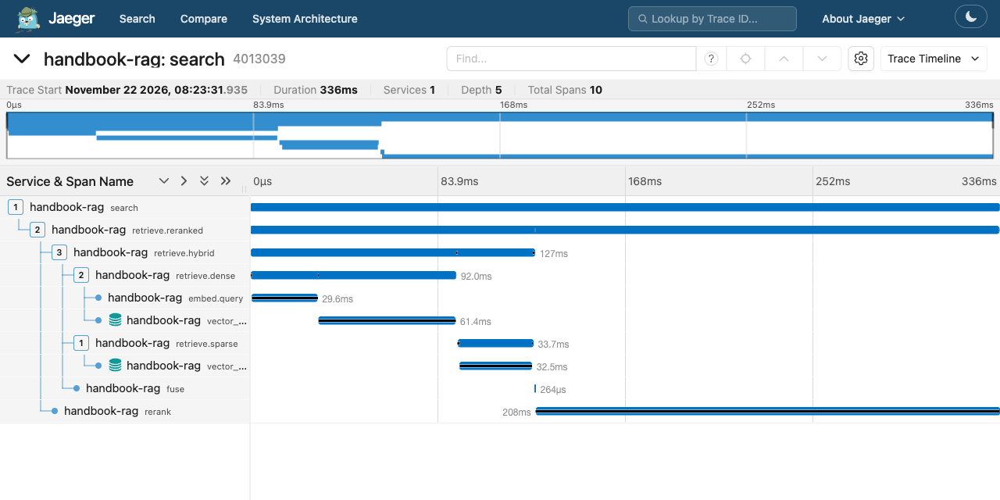

# Observability: reading a trace

When a search is slow or returns the wrong passage, or an answer is wrong, the first question is which stage is responsible. A trace answers it.

- A **trace** is the record of one request.
- It is made of **spans**: named, timed steps that nest inside each other. A trace reads like a call tree with a duration on every line.

The pipeline is instrumented with OpenTelemetry, the vendor-neutral standard ([ADR 0008](adr/0008-opentelemetry-tracing.md)). Tracing is off by default.

## Try it

```bash
make traces                                   # start the trace backend (Jaeger) in Docker
HANDBOOK_RAG_TRACING=true uv run handbook-rag search "how do I expense a laptop"
HANDBOOK_RAG_TRACING=true uv run handbook-rag ask "how do I expense a laptop"
```

Each command prints the id of its trace on the last line, and also when it fails. Open <http://localhost:16686>, choose the service `handbook-rag`, and open the trace, or paste the id into the lookup box.

The command starts a new process each time, so its trace shows a cold start: the first run of the embedding model alone took about 400 ms when measured. The traces below are warm. Each is the last of six searches made in one process, which is how a running service behaves.



This is one search with reranking switched on. The same trace as text:

```
search                           336 ms
  retrieve.reranked              335 ms
    retrieve.hybrid              127 ms
      retrieve.dense              92 ms
        embed.query               30 ms   the embedding model turns the question into a vector
        vector_store.query        61 ms   Qdrant finds the 30 nearest chunks
      retrieve.sparse             34 ms
        vector_store.query        33 ms   Qdrant finds the 30 best keyword matches
      fuse                       0.3 ms   the two lists are merged by rank
    rerank                       208 ms   the cross-encoder reads the question with each of 30 chunks
```

## The trace of an answer

An answer is one trace with our spans at its top: the answer as a whole, the search, and one span for each request to the language model. Most answers take one request. The pipeline opens them itself, so `handbook-rag ask` and `POST /ask` leave the same trace. The evaluation calls the same function, and would too, but it does not switch tracing on.

```
answer                                    the question as a whole
  search                                  the passages found, with their ids and scores
    retrieve.hybrid                       the search's own spans, as in the trace above
      ...
  generate_content gemini-3.5-flash-lite  a request to the model, at the provider, one span for each
```

A real answer, streamed through `POST /ask` on 23 November 2026, as Jaeger showed it. The trace has 13 spans. The first three are the web framework's own:

```
POST /ask                                 1788 ms   the HTTP request, until the last event was sent
  fastapi.dependencies                     0.4 ms   the framework, before the endpoint runs
  fastapi.endpoint                        1472 ms   our endpoint, until the stream began
    answer                                1780 ms
      search                               109 ms   5 passages found
        retrieve.hybrid                    109 ms
          retrieve.dense                    78 ms
            embed.query                     25 ms
            vector_store.query              53 ms
          retrieve.sparse                   30 ms
            vector_store.query              30 ms
          fuse                             0.1 ms
      generate_content gemini-3.5-flash-lite  1671 ms   1,767 tokens read, 133 written, first text after 1.36 s
```

The model call is 1,671 of the 1,788 milliseconds, and the search 109. In a streamed answer the endpoint's own span ends when the stream begins, here after 1,472 ms. The `answer` span was opened inside it and goes on in the worker thread until the answer is complete, so it is the longer of the two.

An answer that takes more than one request has a span for each, in the order they were sent ([ADR 0018](adr/0018-time-limits-retries-and-a-fallback.md)). Here is a real one, asked on the command line on the evening of 23 November 2026, with `gemini-4-hydrogen` as the answer model and `gemini-3.5-flash-lite` as the fallback, while the answer model was overloaded. Nothing worked. Asked from the command line, the trace has no spans of the web framework, and the search's own spans are left out here:

```
answer                                    23.13 s   failed: 4 requests, the fallback used
  search                                            the passages found
    ...
  generate_content gemini-4-hydrogen       0.71 s   attempt 1, failed: unavailable
  generate_content gemini-4-hydrogen       0.75 s   attempt 2, 0.9 s after attempt 1 ended, failed: unavailable
  generate_content gemini-4-hydrogen       0.76 s   attempt 3, 1.4 s after attempt 2 ended, failed: unavailable
  generate_content gemini-3.5-flash-lite  17.63 s   attempt 4, the fallback, failed: unavailable
```

The answer model said "high demand" three times, each within a second, and the pause before each new attempt grew, from about 0.9 to about 1.4 s. Three attempts are the most it is given, so the fallback got its one attempt, and failed too, with `unavailable`, after 17.63 s. There is no span for a pause, for an attempt that the deadline or a provider's wait prevented, or for a fallback that was not asked: a span is always a request that was sent. A model that stays silent looks different: two spans of about 20 seconds, each failed with `timeout`, and no third, because the deadline of 30 seconds has passed by then. In the run that showed it, they took 20.16 and 20.10 s, 0.8 s apart.

The span of the model call is named and described as OpenTelemetry's conventions for generative AI say: its name is the operation (`generate_content` for Gemini, `chat` for Claude) and the model asked for, and it is a client span, the kind for a call to another system. A backend built for language-model applications reads those names; Jaeger shows them like any other attribute.

| Attribute | What it says |
|---|---|
| `gen_ai.provider.name` | Who serves the model: `gcp.gemini` or `anthropic` |
| `gen_ai.request.model`, `gen_ai.response.model` | The model asked for, and the one that served the reply |
| `gen_ai.usage.input_tokens`, `gen_ai.usage.output_tokens` | Tokens read and written. Tokens read from the provider's cache count among those read, and appear again on their own in `gen_ai.usage.cache_read.input_tokens` when there are any |
| `gen_ai.response.finish_reasons` | Why the model stopped, in the words the `ask` command uses, such as `end_turn`, `max_tokens`, `refusal` or `unknown` |
| `gen_ai.response.time_to_first_chunk` | Seconds from the request to the first words of the answer. A model that reasons first sends other pieces before them |
| `handbook_rag.answered` | Whether the reply counts as an answer. Also on the `answer` span |
| `handbook_rag.passages.given`, `handbook_rag.passages.cited` | How many passages the model was given, and how many different ones the reply cites |
| `handbook_rag.passages.cited_chunk_ids` | The passages the reply cites, in the order the answer numbers them |
| `handbook_rag.attempt` | The request's place among the answer's requests, counted from 1, across the answer model and the fallback |
| `handbook_rag.fallback` | Whether the request went to the fallback model |
| `handbook_rag.failure` | On a failed request only: why it failed, in one fixed word, `unavailable`, `timeout`, `rate_limit`, `quota` or `configuration`. It decides whether another attempt followed |

Token counts, model names and passage ids are always recorded. A model call that fails is marked as failed with the kind of error, `handbook_rag.generate.base.GenerationError`, and with the reason in `handbook_rag.failure`. The `answer` span is marked failed only when no answer could be written. It records `handbook_rag.requests` and `handbook_rag.fallback`, how many requests the answer took and whether the fallback model was asked, whether it was written or the model failed. When a caller went away, or the code itself failed, only the model-call spans show the requests. When the search finds nothing, there is no model call, and no span for one: the assistant declines without asking the model.

The `ask` command and `/ask` count tokens read from the cache apart from the others, because they are billed at another price. The trace counts them in, so the two can differ when the provider served part of a prompt from its cache.

## The trace of a cached answer

The command line and the API hand `answer_question` the answer cache ([ADR 0020](adr/0020-an-answer-cache-that-matches-by-meaning.md)). Its lookup is the first span under `answer`, `cache.lookup`. When the cache holds an answer, the trace ends there: no search and no request to the model follow, and the `answer` span records 0 requests.

Three real lookups, from the check of the cache with the real service on 24 November 2026 ([the evaluation guide](evaluation.md#checked-once-with-the-real-service)). The spans of the web framework around them are left out, and so are the search's own spans.

The same question asked a second time, served by the exact tier:

```
answer                                    29.1 ms   0 requests
  cache.lookup                            28.8 ms   hit, tier exact
    vector_store.retrieve                 27.9 ms   the entry under the question's key
```

A rewording, served by meaning:

```
answer                                   163.0 ms   0 requests
  cache.lookup                           162.9 ms   hit, tier semantic, 1 candidate
    vector_store.retrieve                 17.8 ms   nothing under the question's own key
    embed.query                           24.2 ms   the question's vector
    vector_store.query                    29.5 ms   the nearest stored questions
    cache.verify                          90.4 ms   the second model, 1 pair read both ways
```

A near-miss that the second model turned down, so that the answer was written as always:

```
answer                                  1781.9 ms   1 request
  cache.lookup                           268.9 ms   miss, 1 candidate
    vector_store.retrieve                 49.5 ms
    embed.query                           56.9 ms
    vector_store.query                    30.8 ms
    cache.verify                         130.3 ms
  search                                 141.9 ms
    ...
  generate_content gemini-3.5-flash-lite  1370.0 ms
```

| Attribute of `cache.lookup` | What it says |
|---|---|
| `handbook_rag.mode` | The cache's mode: `exact` or `semantic` |
| `handbook_rag.cache.read` | False when the caller asked for a fresh answer, so that nothing was looked up |
| `handbook_rag.cache.hit` | Whether a stored answer was served |
| `handbook_rag.cache.tier` | On a hit: `exact` or `semantic` |
| `handbook_rag.cache.candidates` | How many stored questions the second model was asked about |
| `handbook_rag.cache.similarities` | The cosine of each candidate, nearest first |
| `handbook_rag.cache.entails_forward`, `handbook_rag.cache.entails_backward` | What the second model said of each candidate, in the same order: that the stored question implies the new one, and the other way round. The weaker of the two is compared with the threshold |
| `handbook_rag.cache.failure` | When a tier could not be asked: the kind of error, or `timeout` when the lookup was given up after its 2 seconds. The lookup then counts as a miss, and the span is not marked as failed |

For the near-miss above the three lists held one entry each: a cosine of 0.895544, and 0.092647 and 0.042248 from the second model. With them a trace says why a stored answer was served or was not. `cache.verify` records the second model's name and how many pairs it read. The two calls to the vector store name the cache's own collection in `db.collection.name`.

**The stored questions are questions that people asked**, so they are recorded only when content is on: `handbook_rag.cache.questions` then lists the stored question of each candidate. In the check, with content off, none of the questions asked was in any span.

The answer is stored after the `answer` span has closed, by a thread of its own, and leaves no span: a failure to store is logged, and so is an answer that was still waiting to be stored when the process ended. When the service starts, loading the second model and asking it once is the span `cache.warm_up`, which took 1,106.0 ms in the check. A command loads the second model only when a stored question is near the one asked. That is the span `cache.load_verifier` under `cache.lookup`, and its time does not count towards the lookup's 2 seconds. The check was made before that span existed, and before a lookup had a time limit.

## Through the HTTP API

A request to the API is traced the same way. Its response carries the trace id in `trace_id` and in the `X-Trace-Id` header, and the header is also on a failed request, which is the one a caller most needs an id for. The web framework adds its own spans around ours: the trace starts with `POST /search` or `POST /ask`, which records the method, the route and the status code, and our spans sit inside it.

An answer is written in a worker thread, which starts with a copy of the request's context, so its spans stay in the request's trace. A streamed answer carries the trace id in the header and in its `answer` event; an `error` event carries only its `detail`, and the header is sent all the same. A request to `/ask` that is turned away before an answer starts, because the service is full or answering is not configured, carries no trace id. A caller who leaves in the middle of a stream stops the model call; the spans of that answer end as failed, with the kind `handbook_rag.streaming.CallerGone`. A caller who leaves before the first text does not stop the attempts: the stop is noticed at the next piece of text, so the attempts and their pauses go on until then.

Requests to `/health` are not traced. Something asks for it every few seconds, and those traces would bury the ones made by people. Neither is any request to the demo page's three addresses, `/`, `/static/demo.js` and `/static/demo.css`, whatever its method, and also while the page is switched off: a page load is not a question. A question asked on the page is a request to `/ask`, traced like any other ([ADR 0016](adr/0016-a-demo-page-without-a-build-step.md)).

Start the service with `HANDBOOK_RAG_TRACING=true make serve`.

## What each span records

| Span | What it covers | Worth looking at |
|---|---|---|
| `answer` | One question, from search to answer | `answered`, `query.chars`, `requests`, `fallback` |
| `cache.lookup` | What the answer cache did with the question, when the caller has a cache | The table in the section on a cached answer, above |
| `cache.verify` | The cache's second model, when a stored question was near | `model` and `pairs` |
| `cache.load_verifier` | A command loading the cache's second model, the first time a stored question was near | `model` |
| `generate_content <model>` or `chat <model>` | One request to the language model; an answer can have several | The table in the section above |
| `search` | The whole search: the request to `/search`, or the search inside an answer | `mode` (for `/search`), and the ids, pages and scores of what was returned |
| `retrieve.reranked` | Search plus reranking, when reranking is on | The final order |
| `retrieve.hybrid` | Both searches and the merge | `candidates`: how many each search was asked for |
| `retrieve.dense` | Search by meaning | The chunks it found, before merging |
| `embed.query` | The embedding model | `model` |
| `retrieve.sparse` | Search by keyword | `query.terms`: how many words were left after stop words were removed |
| `vector_store.query` | One call to Qdrant | `vector` (dense or sparse) and the collection |
| `fuse` | Reciprocal rank fusion | `fuse.in_both`: how many chunks both searches returned |
| `rerank` | The cross-encoder | `model` and `candidates` |

Every `search` and `retrieve.*` span carries `results.count`, `results.chunk_ids`, `results.doc_ids` and `results.scores`. A `vector_store.query` span carries the count only, because the span around it has the rest. Our own attributes start with `handbook_rag.`. The database spans also use the standard `db.*` names, which is why Jaeger shows them with a database icon.

## What is not recorded

A trace holds ids, scores, sizes, token counts and timings, and the names of things: the collection, the models, the handbook section a search was limited to. It does not hold what was asked, what was found or what was answered.

- **The question** is recorded as its length only. Questions can contain personal or confidential details, and traces are usually kept longer and read by more people than the application's own data.
- **The answer's text** is left out for the same reason: it can repeat what the question said.
- **Chunk text** is never copied into a trace. A chunk id leads back to the text in the index.
- **The stored questions** that the answer cache compared a new question with are left out, like the question itself: only their number and their scores are recorded.
- **The prompt** sent to the model is not recorded. It is the question, the instructions and the passages, and the passages can be found by their ids.
- **An error** is recorded as its kind only, for example `handbook_rag.index.store.VectorStoreError`. An error message can quote the input that caused it, and a stack trace holds file paths from the machine it ran on.

`HANDBOOK_RAG_TRACE_CONTENT=true` adds the question's text, the answer's text with its citation markers (on the `answer` span), the stored questions the cache compared it with (on `cache.lookup`), and the full message and stack trace of an error, for debugging on your own machine.

## Using a trace to debug

**"It was slow."** Find the longest bar. In the trace above the reranker takes 208 of 336 ms.

One trace is one measurement, and on a busy laptop they vary: the search part of that trace took 127 ms, and the same question without reranking took 36 ms a moment earlier. For typical figures, 40 warm searches without reranking had a median of 43 ms, of which the embedding model took 18 and the two Qdrant calls 13 and 11. These were measured before the fix described below.

**"The right passage was not returned."** Look for its page among `results.doc_ids`, stage by stage.

- It is in `retrieve.dense` or `retrieve.sparse` but not in the final list: the merge or the reranker pushed it out. Compare its rank in each list.
- It is in neither: no search found it within its 30 candidates. That is a question of wording or of how the page was chunked. Asking each search for more candidates (`HANDBOOK_RAG_FUSION_CANDIDATES`) is the only setting that could bring it in, and the merge constant cannot.
- `query.terms` is 0: the question contained only stop words, so keyword search had nothing to match on.
- `fuse.in_both` is low: the two searches disagree, and each result rests on one of them. In the trace above they share 6 of their 30 candidates.

**"It failed."** The failing span is marked as an error with the kind of exception, and so is every span around it. A search against a collection that was never built fails in `vector_store.query` with a `CollectionMissingError`; the command line prints the message, "Collection ... does not exist yet". The span of a failed store call also records, in `error.type`, the kind of error the store's client raised underneath. A failed model call is a `GenerationError` on the model call's span, and `handbook_rag.failure` says which kind of failure it was, such as `timeout` or `quota`, in a fixed word that is always recorded. The error's own message is in the service's log next to the trace id, and in the trace only with content switched on. Several failed model calls in a row, under a failed `answer` span, mean that every attempt failed; the last one is what the caller was told about.

**"The answer is wrong."** Read the trace from the top down, and stop at the first stage that looks wrong.

1. **Was the right passage found?** Look for its page among `results.doc_ids` on the `search` span, and use the steps for a missing passage above. If it is not there, the model never saw it, and no prompt can fix that. `passages.given` on the model call says how many passages the model had.
2. **What did the model call say?**
   - `finish_reasons` is `end_turn`: the model finished. `max_tokens`: it was cut off at the token limit, and the reply may still count as an answer. Anything else, such as `refusal` (the provider withheld the reply) or `unknown`, means the reply did not come to a proper end, and it does not count as an answer.
   - `answered` is false and the reply ended normally: the assistant declined. With the right passage among the results, it should not have; with content on, the answer's text shows how it put that.
   - `answered` is true and `passages.cited` is 0: the model answered without citing anything, which the `ask` command flags as an answer to treat with caution.
   - Was the right passage cited? `passages.cited_chunk_ids` lists the passages the reply cites, in the order the answer numbers them, so `[1]` in the answer is the first id. Compare them with `results.chunk_ids` on the `search` span. With content on, the markers in the answer's text say which statement rests on which of them.
3. **Tokens and time.** `output_tokens` far above the usual for a short answer, or a late `time_to_first_chunk`, means the model spent its time reasoning before it wrote.

There is no span for the model call when the search found nothing: the assistant then declines without asking the model, and the `search` span shows `results.count` 0.

## What the first traces showed

Reading a handful of traces turned up three things that the summary numbers had not:

1. **The two searches run one after the other.** Neither needs the other's result. Run side by side, a hybrid search should take about as long as the slower of the two, which would save roughly the time of the keyword search: an estimated 8 to 11 ms.
2. **Every call to Qdrant was two round trips.** The store asked whether the collection exists before it queried it, and a hybrid search paid for that twice.
3. **Reranking is most of a reranked request.** It is 62% of the trace above, in which the search part was unusually slow. By the medians recorded in [ADR 0011](adr/0011-hybrid-retrieval-by-default.md), 247 ms with reranking against 33 without, it is nearer 87%. That is the cost the decision record weighed against its gain.

Neither of the first two would have been found by looking at one total.

**The second is fixed.** The store now asks whether the collection exists only after a query has failed, to explain the failure. Measuring the gain needed some care: the time of a whole run varies by ten milliseconds from one run to the next on a busy laptop, which hides a difference of a few. So both versions were timed back to back on the same 300 queries, in alternating order, and compared pair by pair, the same way two search variants are compared in the [evaluation guide](evaluation.md).

| | Median time of one store query |
|---|---|
| Asking first | 18.1 ms |
| Asking only after a failure | 12.7 ms |

A query got 5.9 ms faster on average (95% interval 4.8 to 7.0), and was faster in 256 of the 300 pairs. That was on a busy laptop, and only dense queries were timed. On a quieter run the check took about 3 ms on its own, so the size of the saving depends on how loaded the machine is. What does not depend on it: every query now makes one round trip where it made two.

**The first is left as it is.** Running the two searches side by side would save an estimated 8 to 11 ms and add threads to the search path. Once answers are generated, a request will spend a second or more in the language model, and nobody would notice the difference. It is written down so that it is a decision and not an oversight.

## When no trace backend is running

With tracing switched on and nothing listening, a search still works and still exits with success. The trace is lost: the exporter retries for up to three seconds, which is its time limit, then says that the spans could not be exported. The command still prints a trace id, which then leads nowhere.

## Which backend

The local backend is [Jaeger](https://www.jaegertracing.io/): one container, a download of 53 MB, that used 20 to 35 MB of memory here and accepts OTLP directly. Spans are sent over OTLP, so another backend needs a different `HANDBOOK_RAG_OTLP_ENDPOINT` and no change to the code. A hosted backend also wants a credential, which the exporter reads from the standard `OTEL_EXPORTER_OTLP_TRACES_HEADERS` variable.

The span of a model call carries the names of OpenTelemetry's conventions for generative AI, so a backend built for language-model applications can read it without a change to the code. Jaeger stays the local backend. Trying such a backend is a change of `HANDBOOK_RAG_OTLP_ENDPOINT`, and has not been done.

## Not traced yet

- **Evaluation runs and indexing.** An evaluation run records per-question latency in its own files. An evaluation calls the same pipeline, so with tracing switched on each question would leave a trace, but nothing switches it on there.
- **Storing an answer in the cache.** It happens after the answer's trace has ended, and a failure is logged.
- **The prompt sent to the model**, by design, and the answer's text unless content is switched on: see what is not recorded, above.
